# Repository and How to Run the Code

- **GitHub username:** Graf-J
- **Repository:** [MLDS-Q4-490-Advanced-Algorithms-HW1](https://github.com/Graf-J/MLDS-Q4-490-Advanced-Algorithms-HW1) (public)

The project uses [uv](https://docs.astral.sh/uv/) for Python (3.14) and its dependencies:

```bash
git clone https://github.com/Graf-J/MLDS-Q4-490-Advanced-Algorithms-HW1.git
cd MLDS-Q4-490-Advanced-Algorithms-HW1
uv sync            # creates .venv with the exact versions from uv.lock
uv run jupyter lab # or open the notebooks in VS Code with the .venv kernel
```

# 2 Value and Policy Iteration

## 2.0 Model and Shared Environment

| Element | Definition |
|---|---|
| State $s_t$ | Number of customers waiting at the start of period $t$ |
| Action $a_t$ | `DISPATCH` or `WAIT` |
| Transition | $s_{t+1} = \max(0,\ s_t - K \cdot \mathbb{1}[\text{dispatch}]) + A_t$, with $A_t \sim \text{Unif}\{1, \dots, 5\}$ |
| Reward | $r_t = -\big(c_f \cdot \mathbb{1}[\text{dispatch}] + c_h \cdot \max(0,\ s_t - K \cdot \mathbb{1}[\text{dispatch}])\big)$ |
| Parameters | $K = 15$, $c_f = 100$, $c_h = 2$ |

**Order of events within a period:** (1) decide whether to dispatch, (2) pay $c_h$ for every customer left behind, (3) new customers arrive and are first charged in the next period.

The environment (`src/environments/shuttleenvironment.py`) is shared by all subparts of Part 2. Its method `transitions(s, a)` returns every possible outcome as a `(probability, next_state, reward)` tuple, and all solvers use only this method.

### Environment Validation (`2_ValidateEnvironment.ipynb`)

Starting from $s_0 = 0$, I propagated the exact state distribution $P(S_t = s)$ for 20 steps, using fixed policies whose outcome can be predicted by hand:

| Arrivals | Always `DISPATCH` | Always `WAIT` |
|---|---|---|
| Always 1 | $s_t = 1$ ✓ | $s_t = t$ ✓ |
| Always 5 | $s_t = 5$ ✓ | $s_t = 5t$ ✓ |
| Unif$\{1..5\}$ | Uniform on $\{1..5\}$, mean 3 ✓ | Support $[t, 5t]$, mean $3t$ ✓ |

In every case, the probabilities sum to 1 at each step.

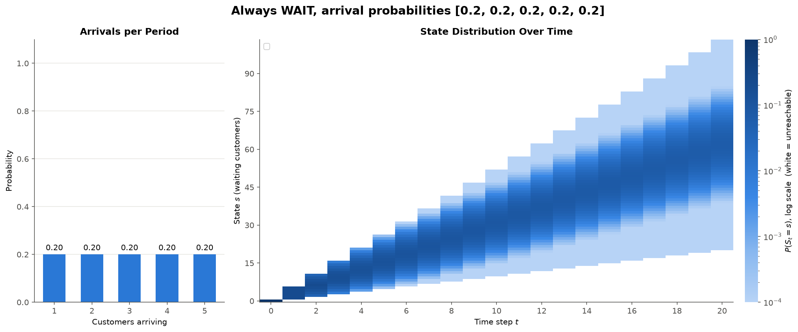
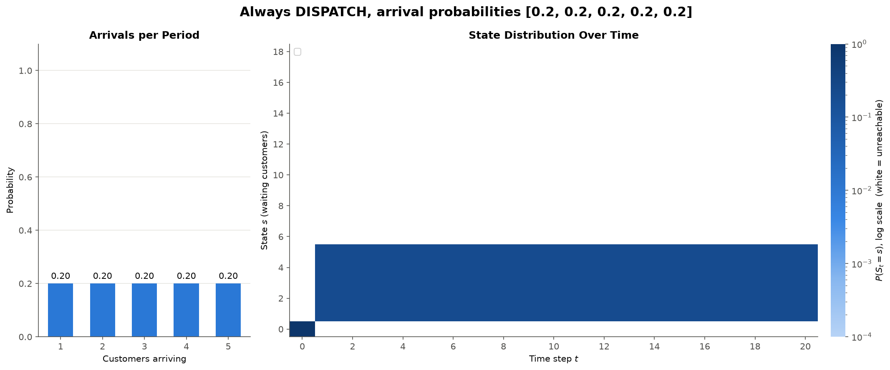

---

## 2a) Enumeration ($T = 500$)

**Notebook:** `2a_Enumeration.ipynb`. **Solver:** `src/solvers/shuttleenumeration.py`.

**Method:** backward induction. Starting from $V_T \equiv 0$, I compute for $t = T-1, \dots, 0$

$$V_t(s) = \max_{a} \mathbb{E}_{A_t}\big[r(s, a) + V_{t+1}(s')\big],$$

and the optimal action is the corresponding $\arg\max$. The solve takes about 6 s.

**Assumptions:**
- Initial states $s_0 \in \{0, \dots, 50\}$.
- No discounting ($\gamma = 1$): the horizon is finite, so all values are finite anyway. $\gamma = 0.95$ is used in 2b and 2c.
- No terminal cost ($V_T \equiv 0$).
- No cap at 200 customers: every reachable state is kept (see the edge cases).

### Optimal Value Function at $t = 0$

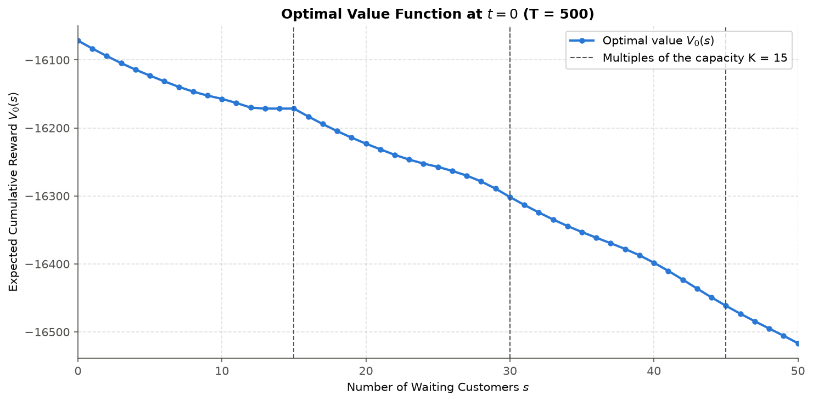

- **Decreasing in $s$:** more waiting customers always means more future cost. $V_0(0) = -16{,}071.6$, about 32 per period.
- **Flat for $s = 13$–$15$:** here $V_0(s) = V_0(0) - 100$ exactly. The optimal action dispatches, the shuttle takes everyone, and the system is back at an empty queue for the price of one dispatch.
- **Kinks at multiples of $K = 15$:** each further block of 15 customers needs one more shuttle.

### Optimal Policy and Simulated Behaviour

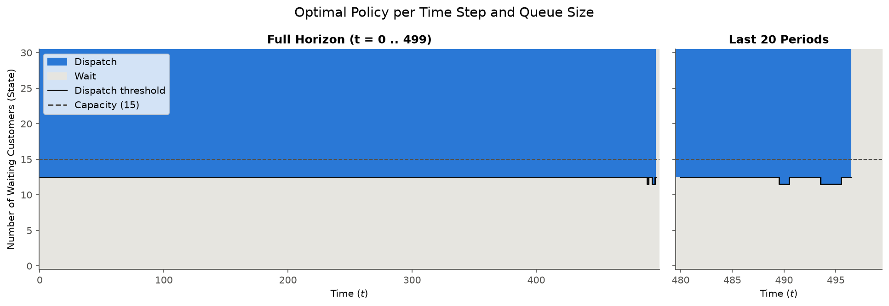

The optimal policy is a **threshold policy: dispatch if and only if $s \geq 13$**, for $t = 0, \dots, 489$. Near the end of the horizon:
- The threshold briefly drops to 12.
- In the last 3 periods, the policy never dispatches. A dispatch removes at most 15 customers and therefore saves at most $3 \cdot 15 \cdot c_h = 90 < c_f = 100$.

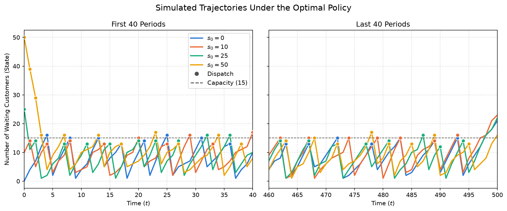

Simulating the policy from $s_0 \in \{0, 10, 25, 50\}$ shows exactly the expected behaviour:
- **Large initial queues are brought down immediately.** From $s_0 = 50$, the policy dispatches in four consecutive periods ($50 \to 39 \to 29 \to 16 \to 4$).
- **Afterwards, all trajectories follow the same sawtooth.** The queue builds up until it reaches 13 and is then emptied.
- **The remaining variation is only due to random arrivals.** Because at most 5 customers arrive per period, the queue at a dispatch is always between 13 and $12 + 5 = 17$ (observed: 13–17, mean 14.3). The time between dispatches ranges from 3 to 8 periods, with a mean of 4.7, which matches $\approx 14.3 / \mathbb{E}[A] = 14.3 / 3$.
- **At the end of the horizon, queues grow unchecked** (16–23 customers at $T$), consistent with the policy map.

### Edge Cases

| Edge case | Handling |
|---|---|
| Fewer than $K$ customers (or none) when dispatching | The remaining queue is $\max(0, s - K)$, so it is never negative. The dispatch still costs $c_f$, so the optimal policy never dispatches an empty station unless $c_f = 0$. |
| Unbounded queue growth | At most 5 customers arrive per period, so `V[t]` holds the $50 + 5t + 1$ reachable states (the $+1$ because `range` excludes the upper bound). Every successor state therefore exists: exact values, no truncation or boundary effects. The 200 cap is never needed, since the optimal policy keeps the queue at 17 or below. |
| Invalid arrival distribution | A `ValueError` is raised for mismatched lengths, negative probabilities, or probabilities that do not sum to 1. The sum is checked with `math.isclose`, so rounding errors such as $5 \times 0.2$ are accepted. |
| Ties between actions | `get_action` returns the first maximiser (`DISPATCH`). Ties only occur in degenerate cases, e.g. $c_f = 0$ at $s = 0$. |
| End of the horizon | $V_T \equiv 0$ makes leftover customers free, so the policy stops dispatching in the last 3 periods. This is a property of the model, not a bug. |

### Tests for Validating Correctness

The tests are in the **Correctness Checks** section of `2a_Enumeration.ipynb` and run top to bottom with the notebook. Each test prints `[PASS]` / `[FAIL]`, and all of them pass.

**1. Remove the stochasticity.** With exactly 3 arrivals per period, the problem is deterministic, so the optimum is the best of all $2^T$ action sequences. For $T = 12$ (4,096 sequences) and every $s_0 \in \{0, \dots, 30\}$, the DP value equals the brute-force optimum exactly (max error 0).

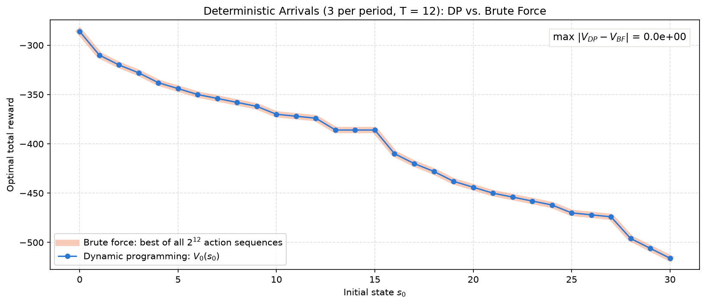

**2. Extreme parameters with obvious answers** ($T = 60$):

| Setting | Expected and observed |
|---|---|
| $c_h = 0$ | Never dispatch, $V \equiv 0$ |
| $c_f = 0$, or $c_h = 200 > c_f$ | Dispatch whenever $s \geq 1$ |
| $K = 0$ | Never dispatch, $V_0(0) = -c_h\,\mathbb{E}[A]\,\frac{T(T-1)}{2} = -10{,}620$ |

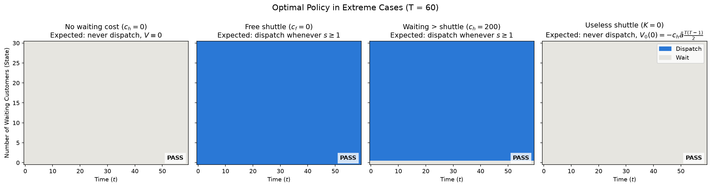

**3. Parameter sweeps.** I changed one parameter at a time and recorded the dispatch threshold at $t = 0$:

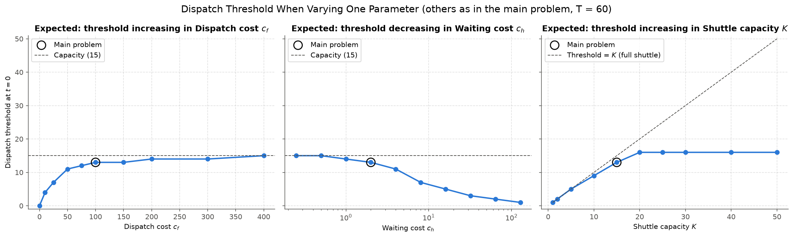

| Change | Threshold | Reason |
|---|---|---|
| Dispatch cost $c_f$ ↑ | Rises, 0 → 15 | An expensive shuttle is worth filling up first. |
| Waiting cost $c_h$ ↑ | Falls, 15 → 1 | Expensive waiting forces earlier dispatches. |
| Capacity $K$ ↑ | Rises, then flat at 16 | Once the shuttle is large, capacity stops being the bottleneck. |

The threshold never exceeds $K$, and the policy stays threshold-shaped in all 30 variants.

**4. First 10 steps.** For one simulated trajectory, I checked at every step that $V_t(s_t) = \max_a Q_t(s_t, a)$, that the action is the $\arg\max$, and that the reward matches the formula.

| $t$ | 0 | 1 | 2 | 3 | 4 | 5 | 6 | 7 | 8 | 9 |
|---|---|---|---|---|---|---|---|---|---|---|
| $s_t$ | 0 | 3 | 8 | 9 | **14** | 2 | 5 | 10 | **13** | 3 |
| $Q(\text{D}) - Q(\text{W})$ | −100.0 | −66.9 | −25.0 | −19.1 | **+17.7** | −77.2 | −48.5 | −14.3 | **+7.2** | −66.9 |
| Action | W | W | W | W | **D** | W | W | W | **D** | W |
| Reward | 0 | −6 | −16 | −18 | −100 | −4 | −10 | −20 | −100 | −6 |

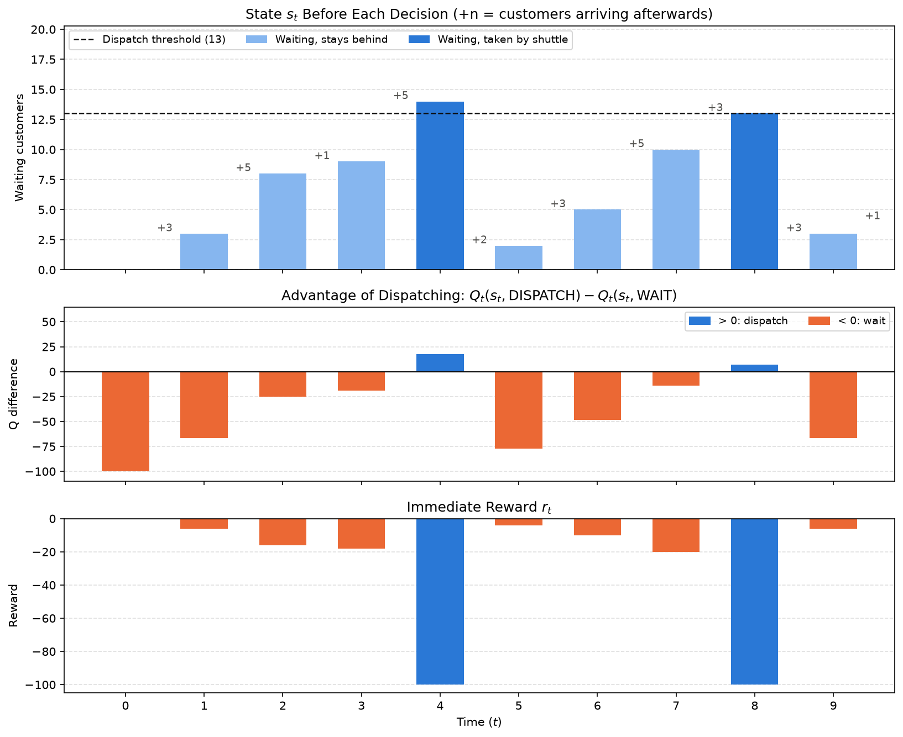

The advantage of dispatching grows as the queue fills up. It turns positive exactly when the threshold of 13 is reached, and the queue is then emptied.

**5. Optimal vs. other policies.** Starting from $s_0 = 0$, I compared $V^*$ with simulated rollouts and with the *exact* expected values (computed by exact policy evaluation) of a random policy and of every fixed threshold rule "dispatch if $s \geq k$":

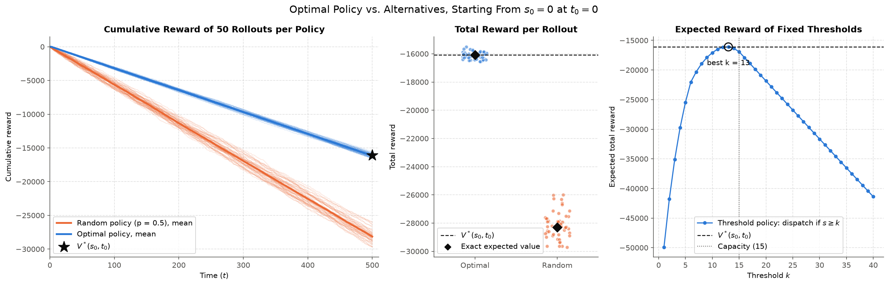

| Policy | Expected total reward |
|---|---|
| **Optimal, $V^*_0(0)$** | **−16,071.6** |
| Optimal, mean of 50 rollouts | −16,120.5 (sampling noise around $V^*$) |
| Best fixed threshold, $k = 13$ | −16,099.9 |
| Random, dispatching with probability 0.5 | −28,299.9 (all 50 rollouts below $V^*$) |

No other policy beats $V^*$. The best fixed threshold is the one the DP found ($k = 13$); it is slightly worse than $V^*$ only because the optimal policy also adapts near the end of the horizon.

---

## 2b) Value Iteration ($T = \infty$)

**Notebook:** `2b_ValueIteration.ipynb`. **Solver:** `src/solvers/shuttlevalueiteration.py`.

**Method:** starting from $V \equiv 0$, I repeatedly apply the Bellman optimality update to every state $s \in \{0, \dots, 200\}$:

$$V(s) \leftarrow \max_{a} \mathbb{E}_{A}\big[r(s, a) + \gamma\,V(s')\big].$$

The values are updated in place, so later states within a sweep already use the new values. I stop when the largest change in a sweep, $\Delta_k = \max_s |V_k(s) - V_{k-1}(s)|$, drops below $10^{-8}$; this takes 343 sweeps. The policy is the greedy $\arg\max$ with respect to the final $V$.

**Assumptions:**
- Discount factor $\gamma = 0.95$.
- At most 200 customers: a next state above 200 is clamped to 200, i.e. extra customers are turned away (see the edge cases).

### Optimal Value Function

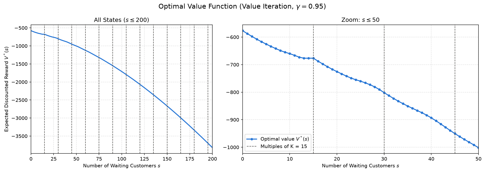

- **Decreasing in $s$:** as in 2a, more waiting customers always means more future cost. $V^*(0) = -576.7$, i.e. $(1 - \gamma)\,V^*(0) \approx -28.8$ per period. This is lower than 2a's 32 per period because discounting weights the cheap first periods after starting from an empty station most.
- **Same shape as 2a:** flat at $s = 13$–$15$, with kinks at multiples of $K = 15$. Tests 1–3 explain these features exactly.

### Optimal Policy and Simulated Behaviour

The optimal policy is again the **threshold policy: dispatch if and only if $s \geq 13$**. This is the same threshold as in 2a, and it holds for all 201 states.

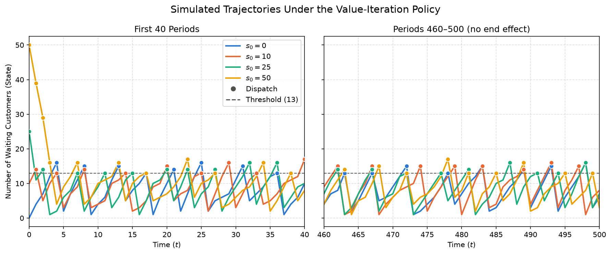

The simulation from 2a, repeated with the value-iteration policy, shows the same behaviour:
- Large queues are cleared immediately, then every trajectory follows the 13 → dispatch sawtooth.
- Every dispatch happens at a queue of 13–17 (mean 14.3), with 3–8 periods between dispatches (mean 4.7).
- **Unlike 2a, there is no end-of-horizon effect.** The policy does not depend on time, so the queue stays at 17 or below until $t = 500$ and beyond. This confirms that the behaviour at the end of 2a came from the finite horizon.

### Edge Cases

The edge cases of the shared environment (dispatching fewer than $K$ customers, invalid arrival distributions) are handled as described in 2a.

| Edge case | Handling |
|---|---|
| Next state above the cap of 200 | `V[min(s', 200)]`: the queue cannot exceed 200, and extra customers are turned away. Doubling the cap to 400 leaves $V^*$ on $s \leq 50$ unchanged (difference exactly 0), so the cap does not affect the states that occur. |
| Invalid discount factor | Value iteration only converges for $0 \leq \gamma < 1$ (with $\gamma = 1$ the infinite sum of costs diverges). Any other value raises a `ValueError`; tested for $\gamma = 1$, $1.5$ and $-0.1$. |
| When to stop | There is no fixed number of sweeps. The solver stops at $\Delta_k < 10^{-8}$. |
| Initial values | $V \equiv 0$. Any starting point converges to the same $V^*$; starting from 0 makes sweep $k$ comparable to a $k$-period enumeration (Test 6). |
| Ties between actions | As in 2a: `get_action` returns `DISPATCH` on a tie, which only happens in degenerate cases. |

### Tests for Validating Correctness

The tests are in the **Checks** section of `2b_ValueIteration.ipynb` and run top to bottom with the notebook. Each test prints `[PASS]` / `[FAIL]`, and all of them pass. Tests 1–3 check that the structure of $V^*$ matches what the model predicts, Tests 4–5 check the iteration itself, and Tests 6–7 compare against two independent methods.

**1. What does one more customer cost?** $V^*(s) - V^*(s-1)$ is the value of one extra waiting customer.

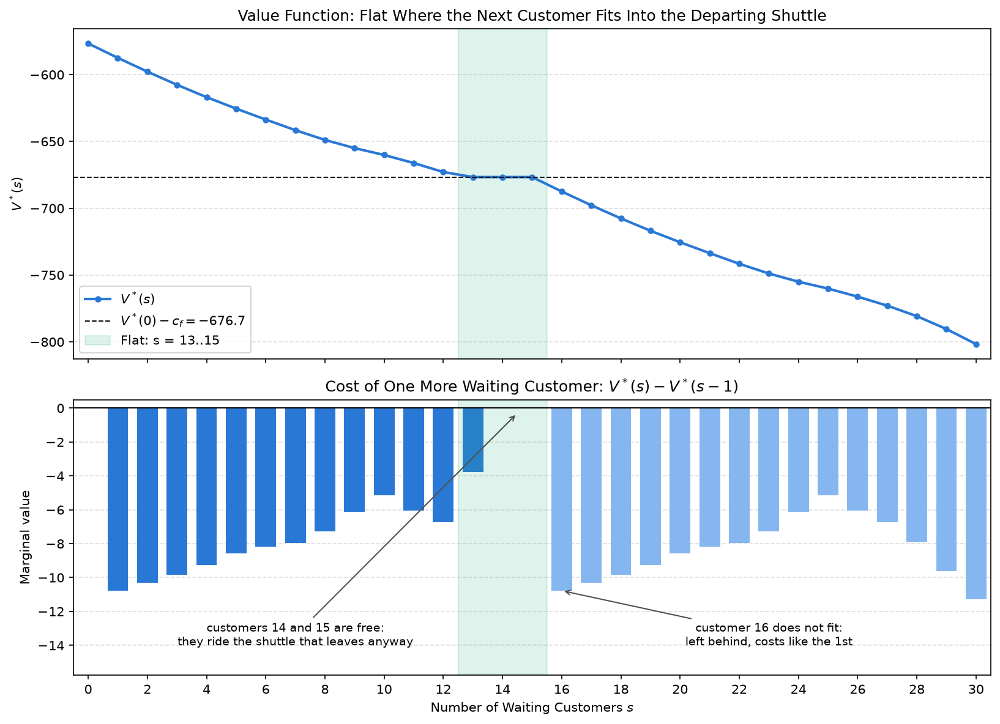

- It is never positive, and it shrinks as the queue approaches the threshold, because a shuttle is coming soon.
- It is **exactly 0 for $s = 14, 15$:** at $s \geq 13$ the policy dispatches anyway, and up to $K = 15$ everyone fits in, so an extra customer just rides along.
- At $s = 16$ it jumps back to $-10.77$, exactly the cost of the very first customer: the 16th customer is left behind alone.

**2. Where does DISPATCH take over from WAIT?** For every $s \leq K$, a dispatch takes everyone, so the system afterwards is exactly where an empty station would be after waiting:

$$Q(s, \text{DISPATCH}) = -c_f + \gamma\,\mathbb{E}[V^*(A)] = V^*(0) - c_f = -676.67 \quad \text{for all } s \leq K.$$

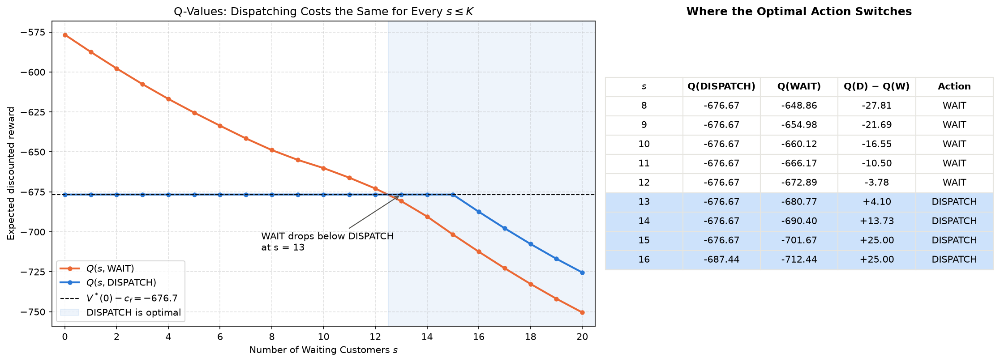

$Q(\text{WAIT})$ decreases with every customer and drops below this constant floor at $s = 13$, the threshold. This also matches 2a.

**3. The value function repeats every $K = 15$ customers.** Dispatching turns $s$ customers into $s - K$ for a price of $c_f$. If the $s - K$ customers left behind are below the threshold, then $V^*(s) = V^*(s - K) - c_f$ exactly.

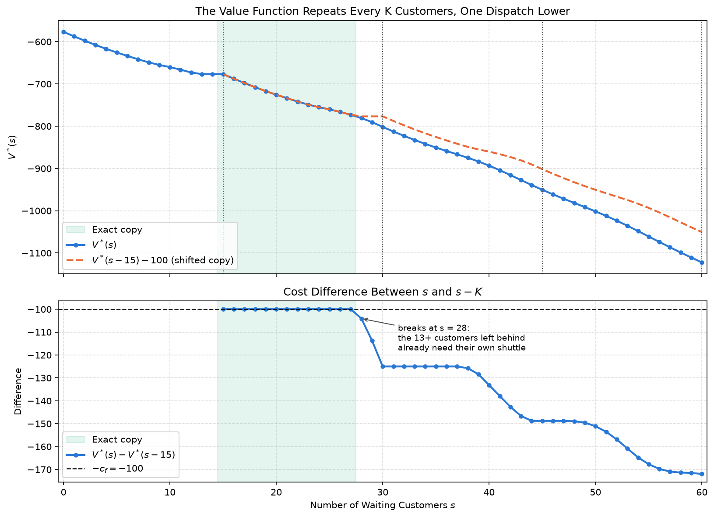

- This holds exactly for $s = 15$–$27$.
- From $s = 28$ on, the customers left behind are themselves at the threshold and need their own shuttle soon, so the gap grows beyond 100.

**4. Convergence.** The Bellman update is a $\gamma$-contraction, so $\Delta_k$ must decay at least as fast as $\gamma^k$, which is a straight line on a log scale.

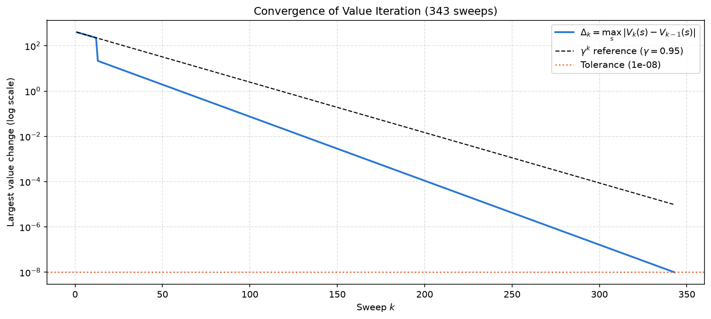

- After a short initial phase, $\Delta_k$ shrinks by a factor of 0.937 per sweep (median over the last 100 sweeps).
- This is slightly faster than $\gamma = 0.95$ because of the in-place updates.

**5. How the Q-values and the policy evolve.** After every sweep $k$, the current $V_k$ defines a greedy policy. The heatmap shows $Q_k(\text{DISPATCH}) - Q_k(\text{WAIT})$ for every sweep and state:

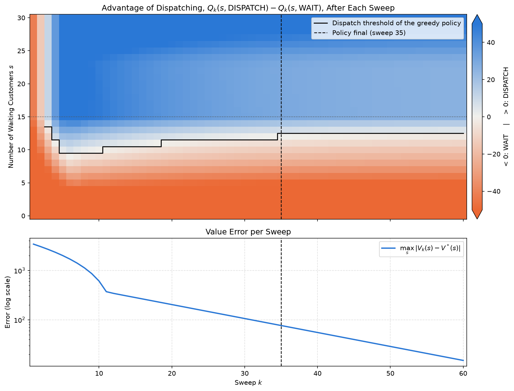

- **Sweeps 1–2:** $V \approx 0$ ignores the future, and waiting (at most $2 \cdot 15 = 30$ per period) looks cheaper than a dispatch (100), so the policy never dispatches.
- **Sweeps 3–34:** the threshold jumps to 14, overshoots down to 10, and then climbs back via 11 and 12.
- **From sweep 35 of 343:** the policy is final at 13, although the values are still up to 77 away from $V^*$. Only the sign of the advantage matters for the action, which is exactly what policy iteration (2c) exploits.

**6. Cross-check with enumeration (2a).** I ran the enumeration solver from 2a with the same $\gamma = 0.95$. Its value for horizon $n$, $V_0^{(n)}$, should approach $V^*$ like $\gamma^n$, since backward induction from $V \equiv 0$ is value iteration started from 0.

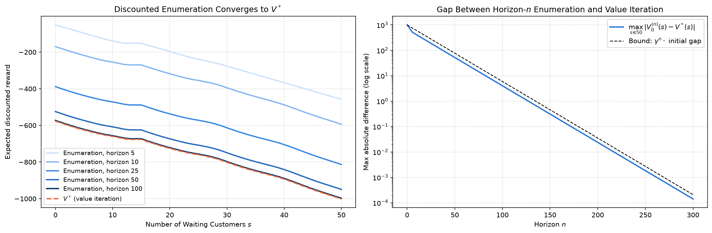

- The gap stays below $\gamma^n \cdot$ (initial gap) for every horizon $n$, reaching $1.4 \cdot 10^{-4}$ at $n = 300$.
- Both solvers choose the same action in every state $s \leq 50$.

---

## 2c) Policy Iteration

**Notebook:** `2c_PolicyIteration.ipynb`. **Solver:** `src/solvers/shuttlepolicyiteration.py`.

**Method:** starting from the policy $\pi_0$ = "always wait", I alternate two steps until the policy no longer changes:
1. **Policy evaluation:** repeat $V(s) \leftarrow \mathbb{E}_{A}\big[r(s, \pi(s)) + \gamma\,V(s')\big]$ for all states until the largest change is below $\theta = 10^{-6}$. Each evaluation starts from the values of the previous policy (warm start).
2. **Policy improvement:** set $\pi(s) \leftarrow \arg\max_a \mathbb{E}_A\big[r(s, a) + \gamma\,V(s')\big]$. An action is only switched if the new one is better by more than the evaluation error $\gamma\theta/(1-\gamma) = 1.9 \cdot 10^{-5}$.

This converges after **6 policy evaluations**.

**Assumptions:** as in 2b ($\gamma = 0.95$, next states clamped at 200), plus the evaluation tolerance $\theta = 10^{-6}$ and the initial policy "always wait".

### Optimal Policy

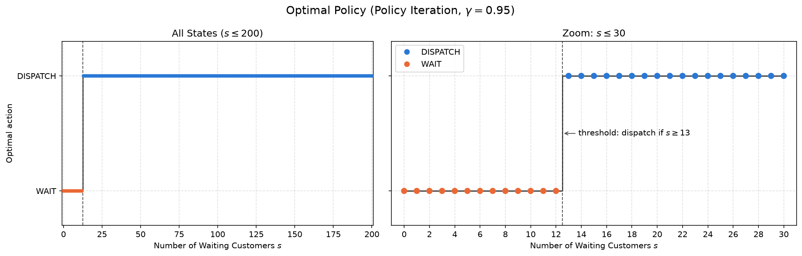

The optimal policy is the **threshold policy: dispatch if and only if $s \geq 13$**. It is identical to value iteration in all 201 states and to the steady-state policy of enumeration. The value function also matches 2b (max difference $1.9 \cdot 10^{-5}$), so it is not shown again.

### Edge Cases

The edge cases of the environment (2a) and of the state cap (2b) apply unchanged; doubling the cap to 400 again leaves policy and values on $s \leq 50$ unchanged.

| Edge case | Handling |
|---|---|
| Ties and evaluation noise | Policy evaluation is only accurate up to $\gamma\theta/(1-\gamma)$. If the solver switched to any action that looks marginally better, two (nearly) equally good actions could swap back and forth forever. It therefore switches only for an improvement larger than this error. Test: with $c_f = c_h = 0$, every Q-value is 0, and the solver keeps its initial policy and stops after one evaluation. |
| Termination | Policy iteration terminates in theory, since there are finitely many policies and each iteration strictly improves. As a safeguard, `max_iterations` (default 100) raises an error instead of looping forever; tested with a limit of 2. |
| Inaccurate policy evaluation | Evaluation stops at $\Delta < \theta$. I checked the result against an exact linear solve (Test 3), and every check that compares values allows for this error. |
| Initial policy | Any policy can be passed in. One that does not cover every state raises a `ValueError`. The result does not depend on it (Test 4). |
| Initial policy "always wait" | This policy never empties the station, so its value depends on the cap: at $s = 200$ it pays $c_h \cdot 200$ forever, $V^{\pi_0}(200) = -2 \cdot 200 / (1 - \gamma) = -8{,}000$ exactly. The clamp keeps this finite and well-defined. |
| Invalid discount factor | As in 2b, $\gamma \notin [0, 1)$ raises a `ValueError`. |

### Tests for Validating Correctness

The tests are in the **Checks** section of `2c_PolicyIteration.ipynb` and run top to bottom with the notebook. Each test prints `[PASS]` / `[FAIL]`, and all of them pass.

**1. How the policy evolves.** Each row shows the policy evaluated in one iteration:

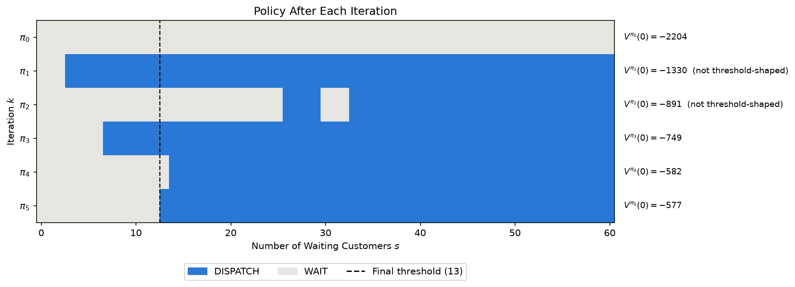

| Iteration | 0 | 1 | 2 | 3 | 4 | 5 |
|---|---|---|---|---|---|---|
| First state with DISPATCH | never | 3 | 26 | 7 | 14 | **13** |
| $V^{\pi_k}(0)$ | −2,204 | −1,330 | −891 | −749 | −582 | **−577** |

- **$\pi_1$ dispatches almost always.** Under "always wait", the queue grows forever, so $V^{\pi_0}$ is very low and dispatching looks attractive almost everywhere.
- **Intermediate policies need not be thresholds.** $\pi_2$ dispatches at 26–29, waits at 30–32, and dispatches again from 33, because it acts greedily on the values of a bad policy.
- **The policy settles in a few steps.** It narrows down to 14 and then to 13. Every iteration except the last changes the policy.

**2. Policy improvement theorem.** Acting greedily on $V^{\pi_k}$ can never make things worse, so $V^{\pi_{k+1}}(s) \geq V^{\pi_k}(s)$ must hold for every state and iteration.

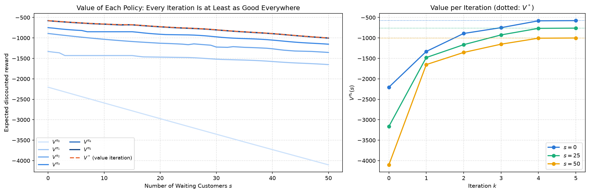

- The smallest improvement over all states per iteration is $+160$, $+110$, $+79$ and $+2.5$.
- The first step shows $-1.8 \cdot 10^{-5}$ at $s = 199$, where both policies wait. This is within the evaluation error.
- The value curves end on $V^*$ from value iteration.

**3. Agreement with exact evaluation and value iteration.** For a fixed policy, the Bellman equation is linear, so $V^\pi$ can also be computed exactly by solving $(I - \gamma P_\pi)\,V = r_\pi$ (a $201 \times 201$ system).

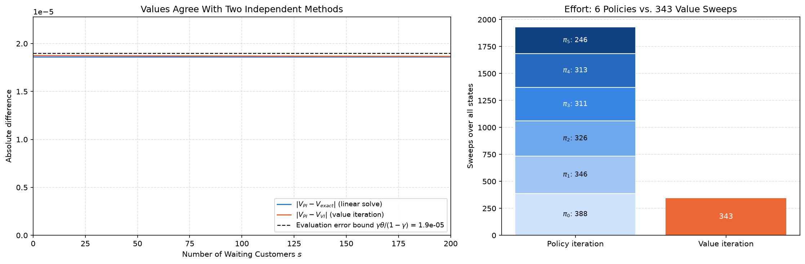

- Policy iteration chooses the same action as value iteration in all 201 states.
- Its values differ from the exact solution by at most $1.86 \cdot 10^{-5}$ and from value iteration by at most $1.87 \cdot 10^{-5}$. Both are below the evaluation error bound of $1.9 \cdot 10^{-5}$.
- **Effort:** policy iteration needs only 6 policies, but evaluating them iteratively costs 1,930 sweeps in total, compared with 343 sweeps for value iteration. Each iterative evaluation is itself a value-iteration-like process to tolerance $\theta$, and the values change a lot between policies, so the warm start helps little. The small number of improvement steps would only pay off with cheaper evaluation, e.g. one exact linear solve per policy, or a looser $\theta$ in early iterations.

**4. Independence of the initial policy.** The optimal policy is unique, so every starting point must lead to it:

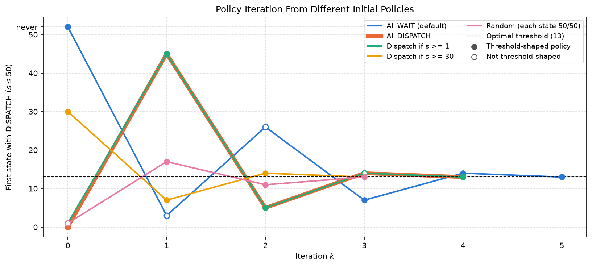

| Initial policy | Evaluations | Evaluation sweeps | First state with DISPATCH per iteration |
|---|---|---|---|
| Always wait (default) | 6 | 1,930 | never → 3 → 26 → 7 → 14 → 13 |
| Always dispatch | 5 | 1,600 | 0 → 45 → 5 → 14 → 13 |
| Dispatch if $s \geq 1$ | 5 | 1,600 | 1 → 45 → 5 → 14 → 13 |
| Dispatch if $s \geq 30$ | 4 | 1,231 | 30 → 7 → 14 → 13 |
| Random (each state 50/50) | 4 | 1,236 | 1 → 17 → 11 → 13 |

All five runs end in exactly the policy from value iteration after at most 6 evaluations.

### Summary of Part 2

| | Enumeration (2a) | Value iteration (2b) | Policy iteration (2c) |
|---|---|---|---|
| Horizon, discount | $T = 500$, $\gamma = 1$ | $\infty$, $\gamma = 0.95$ | $\infty$, $\gamma = 0.95$ |
| Optimal policy | Dispatch if $s \geq 13$ (except the last ~10 periods) | Dispatch if $s \geq 13$ | Dispatch if $s \geq 13$ |
| Work until done | 1 backward pass, 500 steps | 343 sweeps (policy final after 35) | 6 policies, 1,930 evaluation sweeps |

All three methods agree on the same threshold policy. The tests above confirm it in different ways: brute force, closed-form properties of $V^*$, convergence theory, and exact policy evaluation.

---

## 2.4 Question: "Given an Additional 3 Months, What Other Validation Tests and Experiments Would You Perform?"

The problem is small (201 states, 2 actions), and three independent methods already agree, so 3 months is more than this instance needs. I would use the time to check whether the results hold **beyond this instance** and whether the **model assumptions** are right:

- **Random problem instances:** run all three solvers on thousands of random parameter sets ($K$, $c_f$, $c_h$, arrival distributions) and automatically check the invariants from this report: the solvers agree, the policy is a threshold policy, $V^*$ decreases in $s$, and brute force matches on small instances.
- **Discount factor towards 1:** $(1-\gamma)\,V^*(0)$ should approach the long-run average cost of about 32 per period found by enumeration in 2a. This would connect the finite-horizon and the discounted results.
- **Cheaper policy evaluation:** replace the iterative evaluation in 2c, which dominated the runtime, with an exact linear solve per policy. Then compare runtimes on larger state spaces.
- **Stress the model:**
  - High load ($\mathbb{E}[A] > K$), where the cap of 200 actually binds.
  - Time-varying (rush-hour) arrivals, where the threshold should change over the day.
  - A policy tuned for the wrong arrival distribution, to see how much reward it loses.
- **Benchmark for learning algorithms:** since the exact optimum is known, check whether model-free methods (Q-learning, policy gradient) learn the threshold of 13 from simulation alone.

# 3 Policy Gradient: Part 1

## 3a) CartPole-v1

**Notebook:** `3a_CartPole-v1.ipynb`. All figures are saved to `report/figures/3a_*.png` when the notebook runs. The four main trainings take about 12 min; the seed experiment takes another 45 min.

**Method:** REINFORCE (vanilla policy gradient) without a baseline.
- **Policy network:** $4 \to 20$ (ReLU) $\to 1$ logit, with $P(\text{push right} \mid s) = \sigma(\text{logit})$. During training, the action is sampled from this Bernoulli distribution.
- **Update:** after every episode, I compute the discounted returns $G_t = \sum_k \gamma^k r_{t+k}$ and take one Adam step (learning rate 0.01) on the loss $-\sum_t \log \pi(a_t \mid s_t)\, G_t$. The returns are not normalised.
- **Training:** 1,000 episodes. All four state variables start uniformly in $[-0.15, 0.15]$; this is wider than the Gymnasium default of $\pm 0.05$, so the policy also learns to recover from harder start states.
- **Evaluation:** 500 episodes with the greedy action (push right iff $P > 0.5$). Episode $i$ starts from seed $i$, so every variant is evaluated on the same 500 start states.

The function `train(env, policy, optimizer, episodes, gamma, scheduler=None, reward_shaping=False, seed=None)` supports two optional extensions. I add them one at a time on top of the baseline, which uses $\gamma = 0.95$ as the assignment requires:

| Variant | $\gamma$ | Learning rate | Reward used for learning |
|---|---|---|---|
| Baseline | 0.95 | 0.01, constant | Environment reward (+1 per step) |
| 1: bigger $\gamma$ | 0.995 | 0.01, constant | Environment reward |
| 2: + scheduler | 0.995 | Cosine annealing 0.01 → 0.001 over the 1,000 episodes | Environment reward |
| 3: + reward shaping | 0.995 | Cosine annealing 0.01 → 0.001 | $r_t \cdot \varphi(x_{t+1})$, with $\varphi$ the density of $\mathcal{N}(0, 0.7^2)$ |

The shaped reward is $0.570$ with the cart at the center and $0.0016$ at the edge of the track ($|x| = 2.4$), so it pays more for staying centered. It is only used to compute the returns. **All reported rewards are the unshaped environment rewards**, so the variants are directly comparable.

### Baseline: Training and Evaluation

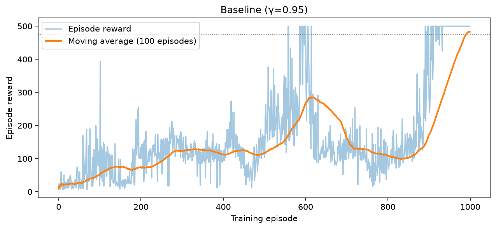

- **Slow and unstable learning:** the moving average stays between 100 and 280 for 900 episodes and collapses once around episode 620. It reaches 475 (the threshold at which CartPole-v1 counts as solved) only at episode 991.
- **During training, the cart leaving the track is the main failure:** this happens in 564 of the 1,000 episodes (Test 6).

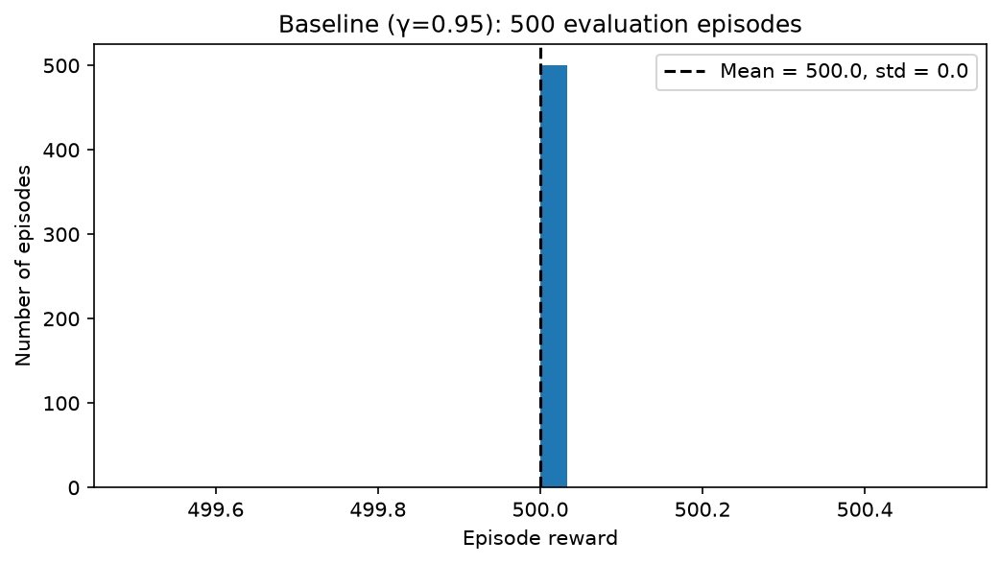

**Evaluation:** all 500 greedy episodes reach the time limit of 500 steps, so **mean = 500.0, std = 0.0**.

### Variants: Bigger $\gamma$, Scheduler, Reward Shaping

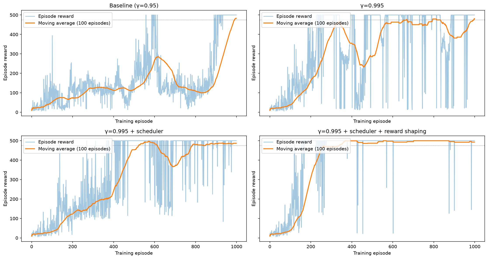
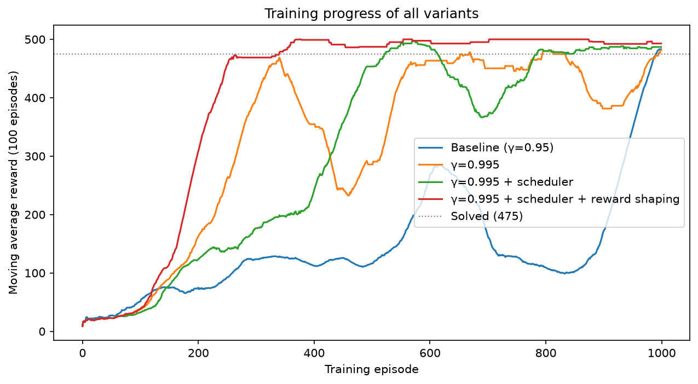

| Variant | Solved at episode | Mean reward over training | Mean of last 100 | Evaluation mean ± std |
|---|---|---|---|---|
| Baseline ($\gamma = 0.95$) | 991 | 167.0 | 483.1 | 500.0 ± 0.0 |
| $\gamma = 0.995$ | 669 | 349.2 | 481.4 | 500.0 ± 0.0 |
| + scheduler | 523 | 333.2 | 486.9 | 500.0 ± 0.0 |
| + reward shaping | **341** | **427.9** | **492.9** | 500.0 ± 0.0 |

The evaluation histograms of the variants look the same as the baseline's: all 500 episodes reach 500 (`figures/3a_histogram_*.png`).

- **Bigger $\gamma$:** learning is much faster (more than doubles the mean reward over training), but unstable. The moving average reaches 470 at episode 330 and then collapses to 240.
- **+ Scheduler:** it still dips once while the learning rate is high (to 370 around episode 690). From episode ~780 on, the learning rate is small enough that it stays above 475, whereas $\gamma = 0.995$ alone collapses again at episode 900.
- **+ Reward shaping:** fastest and most stable. From episode 300 on, almost every episode survives 500 steps (81% of all training episodes).

**For seed 0, all four variants end with a perfect greedy policy.** The hyperparameters therefore improve **how fast and how reliably** training gets there, which the following experiment and Tests 5–6 confirm.

### Robustness Across Training Seeds

One training run can be lucky or unlucky, so I trained every variant with 4 more seeds and evaluated each policy greedily on 100 start states:

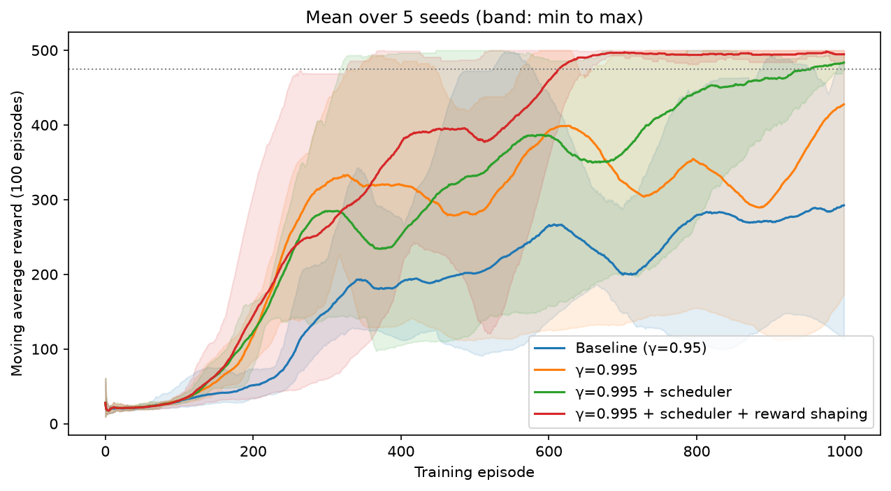

| Variant | Solved at (seeds 0–4) | Mean training reward | Mean of last 100 | Evaluation mean | Seeds with evaluation = 500 |
|---|---|---|---|---|---|
| Baseline ($\gamma = 0.95$) | 991, 525, –, –, – | 192.8 ± 60.4 | 292.4 ± 138.0 | 362.0 | 3/5 |
| $\gamma = 0.995$ | 669, 333, 395, –, 662 | 286.3 ± 78.3 | 427.6 ± 127.6 | 462.2 | 4/5 |
| + scheduler | 523, 753, 806, 319, 995 | 315.6 ± 65.3 | 483.6 ± 7.4 | 497.7 | 4/5 |
| + reward shaping | 341, 327, 659, 494, 604 | **363.3 ± 48.3** | **494.6 ± 6.8** | **500.0** | **5/5** |

(– = not solved within 1,000 episodes)

- **Each addition helps on average.** Seed 0 was a lucky run for the baseline: it reaches 475 in only 2 of 5 seeds.
- **The bigger $\gamma$ mostly speeds up learning.** The scheduler mostly makes the end of training reliable: the spread of the last-100 mean drops from ±127.6 to ±7.4.
- **Reward shaping is the only variant that solves the task and reaches a perfect greedy policy for every seed.**

### Edge Cases

| Edge case | Handling |
|---|---|
| Invalid arguments | `episodes <= 0`, $\gamma \notin (0, 1]$ and a scheduler that wraps a different optimizer raise a `ValueError` (tested). $\gamma = 0$ is excluded because every return would then be the immediate reward of 1, which gives no signal about survival. |
| Time limit (truncation at 500 steps) | Truncated episodes are treated like terminated ones: the return is cut off, even though the pole is still upright. With $\gamma = 0.95$, this only affects the last ~60 steps (Test 1). The limit also caps the evaluation: no reward can exceed 500, and std = 0 means "every episode reached the limit", not a bug. Tested: every reward of 500 is a truncation, every shorter episode a failure. |
| Saturated evaluation | Since all variants reach 500 in the greedy evaluation, I compare them under harder conditions (Test 5) and over 5 seeds. |
| Reward shaping must not make failing attractive | The shaped reward is strictly positive ($\geq 0.0016$) on the whole track, so surviving longer always increases the return. With a negative shaped reward (e.g. $1 - |x|$), ending the episode early could become optimal. Tested over the whole track. |
| Shaped vs. true reward | The shaped reward is only used to compute the returns. All plots and tables use the environment reward. |
| Scheduler | Stepped once per episode with `T_max = episodes`, so the learning rate ends exactly at 0.001 (tested). It is only stepped if one is passed. |
| Scale of the returns | Returns reach up to $1/(1-\gamma)$: 20 for $\gamma = 0.95$ but 200 for $\gamma = 0.995$. Adam's update does not change when all gradients are scaled by a constant factor, so the same learning rate works for both without retuning. |
| Start states | $\pm 0.15$ instead of the default $\pm 0.05$, for training and evaluation. A pole angle of 0.15 rad is already close to the failure angle of 0.21 rad. Starting at $\pm 0.2$ is tested in Test 5. |
| Moving average at the start | The first 99 episodes average over fewer episodes. "Solved at" only counts full 100-episode windows. |
| Reproducibility | `torch.manual_seed` and the seed of the first `env.reset` make training reproducible; training twice gives identical rewards (tested). |

### Tests for Validating Correctness

The tests are in the **Checks** section of `3a_CartPole-v1.ipynb` and run top to bottom with the notebook. They reuse the trained policies from above. Each test prints `[PASS]` / `[FAIL]`, and all of them pass.

**1. Discounted returns and the credit horizon.** For a constant reward of 1, $G_t = \frac{1 - \gamma^{T-t}}{1 - \gamma}$ must hold, and with $\gamma = 1$, $G_t$ must equal the number of remaining steps. `rewards_to_returns` matches both exactly.

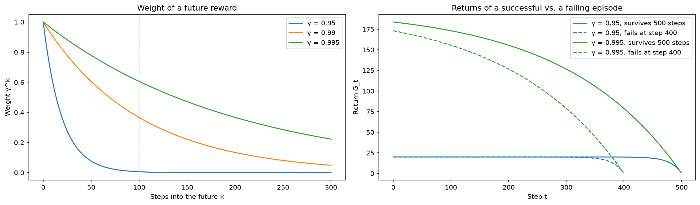

| $\gamma$ | Effective horizon $1/(1-\gamma)$ | $\gamma^{100}$ |
|---|---|---|
| 0.95 | 20 steps | 0.006 |
| 0.99 | 100 steps | 0.366 |
| 0.995 | 200 steps | 0.606 |

With $\gamma = 0.95$, an episode that fails at step 400 has **the same returns as one that survives all 500 steps for the first ~340 steps**. A slow drift of the cart, which only causes a failure much later, is therefore barely punished. With $\gamma = 0.995$, the later failure lowers the return already at step 0 (173 vs. 183). Test 6 checks whether this explains the cart failures of the baseline.

**2. Control experiments.** Three short trainings (300 episodes, $\gamma = 0.95$) that only differ in the learning signal:

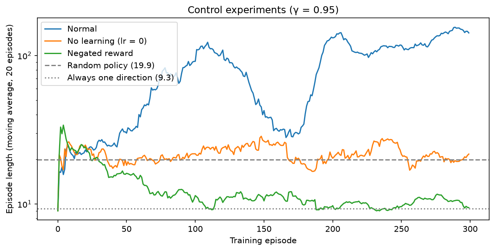

| Training | First 100 episodes | Last 100 episodes | Expected |
|---|---|---|---|
| Normal | 50.9 | 123.2 | Clearly increases ✓ |
| Learning rate 0 | 20.9 | 21.7 | Flat (the policy never changes) ✓ |
| Negated reward (−1 per step) | 15.4 | 10.2 | Learns to fail as fast as possible ✓ |
| *Reference:* random policy | 19.9 | | |
| *Reference:* always push in one direction | 9.3 | | |

With the reward flipped, the same code learns the opposite behaviour, getting close to the fastest simple way to fail. This shows that the gradient points in the right direction, and that the improvement in normal training comes from the learning signal, not from chance.

**3. First 10 steps.** The trained baseline policy, with sampled actions as in training, starting with the pole leaning left ($\theta = -0.138$):

| $t$ | 0 | 1 | 2 | 3 | 4 | 5 | 6 | 7 | 8 | 9 |
|---|---|---|---|---|---|---|---|---|---|---|
| $\theta$ | −0.138 | −0.141 | −0.139 | −0.132 | −0.131 | −0.126 | −0.116 | −0.101 | −0.092 | −0.078 |
| $\dot\theta$ | −0.15 | 0.10 | 0.35 | 0.01 | 0.26 | 0.51 | 0.76 | 0.43 | 0.69 | 0.37 |
| $P(\text{right})$ | 0.03 | 0.05 | 0.14 | 0.03 | 0.08 | 0.24 | **0.59** | 0.16 | 0.48 | 0.12 |
| Action | L | L | R | L | L | L | R | L | R | L |

- **The policy pushes towards the side the pole leans to** (left), in 9 of 10 steps, so the cart moves back under the pole. It only becomes unsure when the pole already swings back quickly ($\dot\theta = 0.76$ at $t = 6$).
- **As a result, $|\theta|$ shrinks** from 0.138 to 0.071.
- The shaped reward stays at 0.568–0.570, the maximum, since the cart stays near the center.

**4. Does the policy react correctly to the pole?** I vary the pole angle $\theta$ and the angular velocity $\dot\theta$ one at a time, with all other state variables at 0:

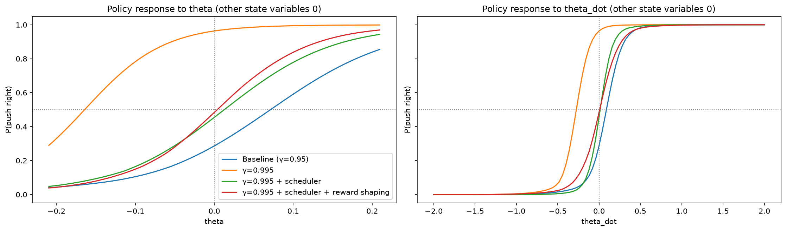

- For all four policies, $P(\text{right})$ increases monotonically in both, is below 0.5 at the negative end and above 0.5 at the positive end (8/8 PASS). This is the physically correct direction: when the pole leans or falls to the right, the cart must move right.
- **The $\gamma = 0.995$ policy is biased:** it pushes right with probability 0.96 even when the pole is perfectly upright. This explains its drift in Test 6.

**5. Harder evaluation.** The greedy evaluation is saturated at 500, so I also evaluate each policy with sampled actions, and with wider start states ($\pm 0.2$):

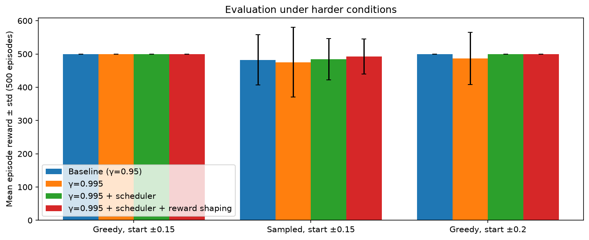

| Variant | Greedy, $\pm 0.15$ | Sampled, $\pm 0.15$ | Greedy, $\pm 0.2$ |
|---|---|---|---|
| Baseline ($\gamma = 0.95$) | 500.0 ± 0.0 | 482.2 ± 75.5 | 500.0 ± 0.0 |
| $\gamma = 0.995$ | 500.0 ± 0.0 | 475.0 ± 104.9 | 486.7 ± 78.2 |
| + scheduler | 500.0 ± 0.0 | 484.6 ± 62.2 | 500.0 ± 0.0 |
| + reward shaping | 500.0 ± 0.0 | **492.5 ± 52.8** | 500.0 ± 0.0 |

The reward-shaping policy is the most robust to the noise of sampled actions. The $\gamma = 0.995$ policy, the one with the bias from Test 4, is the only one that fails from wider start states. Overall, the differences between the final policies of seed 0 are small.

**6. Why do episodes end?** An episode ends when the pole falls ($|\theta| > 12°$), when the cart leaves the track ($|x| > 2.4$), or at the time limit. This checks the explanation from Test 1:

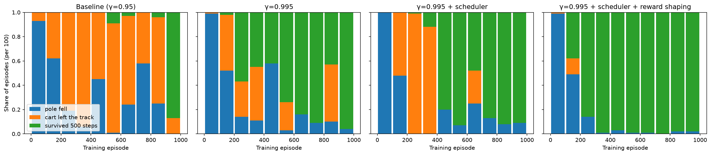

| Variant | Training: cart left / pole fell / 500 steps | Sampled evaluation: cart / pole / 500 | Median max $|x|$ (sampled evaluation) |
|---|---|---|---|
| Baseline ($\gamma = 0.95$) | **564** / 333 / 103 | 0 / 33 / 467 | 0.66 |
| $\gamma = 0.995$ | 190 / 276 / 534 | 0 / 27 / 473 | 1.25 |
| + scheduler | 266 / 230 / 504 | 0 / 43 / 457 | 0.68 |
| + reward shaping | **14** / 172 / 814 | 0 / 11 / 489 | **0.26** |

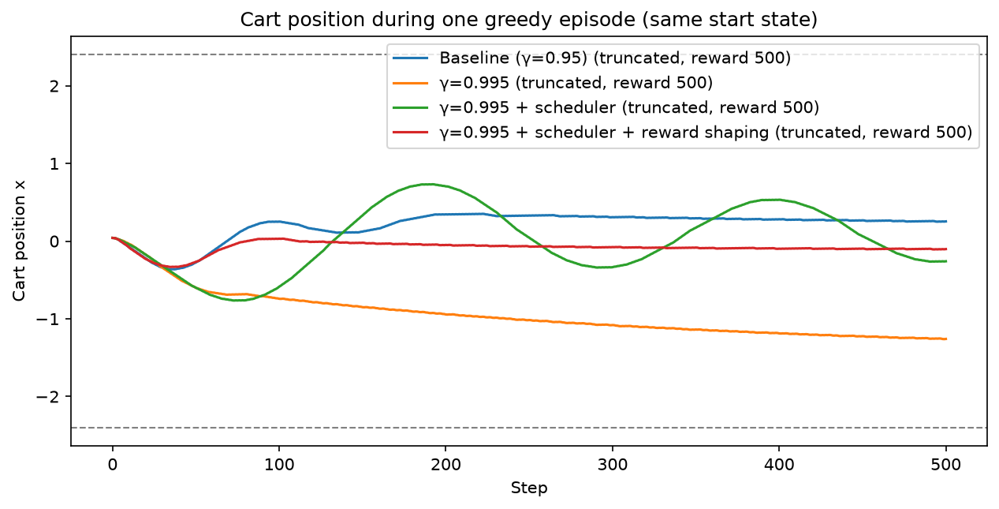

- **During training, the explanation holds.** With $\gamma = 0.95$, the cart leaves the track in 564 episodes, and this is the most common outcome in 6 of the 10 blocks of 100 episodes. The pole is balanced, but the agent does not see that the cart drifts towards the edge. With $\gamma = 0.995$ there are only 190 such failures, and with reward shaping only 14.
- **The final policies no longer leave the track** (0 cart failures in the evaluation). However, only reward shaping keeps the cart centered (median max $|x| = 0.26$). The $\gamma = 0.995$ policy drifts steadily to $x = -1.26$ within 500 steps, because of the bias from Test 4. It would probably leave the track in a longer episode; only the time limit hides this.
- **Conclusion:** a longer horizon makes it possible to learn to avoid the drift, but does not guarantee it. Only reward shaping rewards staying centered explicitly, and only then is the learned policy centered.

### Summary of 3a

| | Baseline ($\gamma = 0.95$) | + $\gamma = 0.995$ | + scheduler | + reward shaping |
|---|---|---|---|---|
| Solved (5 seeds) | 2/5 | 4/5 | 5/5 | 5/5 |
| Mean of last 100 episodes (5 seeds) | 292.4 ± 138.0 | 427.6 ± 127.6 | 483.6 ± 7.4 | 494.6 ± 6.8 |
| Greedy evaluation, seed 0 | 500.0 ± 0.0 | 500.0 ± 0.0 | 500.0 ± 0.0 | 500.0 ± 0.0 |
| Main effect | Short horizon: cart drifts off the track | Faster learning | Stable end of training | Fastest, most stable, cart centered |

Plain REINFORCE with $\gamma = 0.95$ can solve CartPole, but slowly and unreliably. Each added hyperparameter fixes a specific weakness, and reward shaping has the largest effect.

---

## 3b) Pong-v5

**Notebook:** `3b_Pong-v5.ipynb`. All figures are saved to `report/figures/3b_*.png`. Training takes about 100 min; afterwards the policy is saved every 250 episodes to `checkpoints/3b/reinforce/` together with the training log. With `RETRAIN = False` (default), the notebook loads this run instead of training again, so the evaluation and all checks can be rerun in about 30 min.

**Method:** REINFORCE without a baseline, $\gamma = 0.99$.
- **Actions:** only 2 (`RIGHT`) and 3 (`LEFT`), as required. In Pong they move the paddle **up** and **down** (Check 2), so I call them that.
- **Input:** the difference of two consecutive frames, each preprocessed with the given `preprocess` function (80×80, 0/1). A single frame shows where the ball is, but not where it is going. The difference shows moving objects as a +1/−1 pair, which encodes the direction (Check 2).
- **Policy network:** Conv(1→8, 3×3) → ReLU → MaxPool(2) → Conv(8→8, 3×3) → ReLU → MaxPool(2) → Linear(2592→64) → ReLU → Linear(64→1), giving the logit of $P(\text{down})$. Actions are sampled from this Bernoulli distribution.
- **Loss:** $-\sum_t \log \pi(a_t \mid s_t)\, G_t \;-\; 0.01 \sum_t \mathcal{H}[\pi(\cdot \mid s_t)]$, with Adam (learning rate 0.001). The returns are not normalised and no baseline is subtracted.
- **Training:** 2,000 episodes. Gradients are accumulated over 5 episodes per optimizer step and clipped to norm 1.
- **Evaluation:** 500 episodes with actions sampled from the policy, as during training. Episode $i$ starts from seed $i$.

### Deviations from the Plain Algorithm and Why

None of these is a baseline: the learning signal is still the raw discounted return of each action.

| Change | Reason |
|---|---|
| Return restarts after every point | $G_t$ only contains the point of the current rally: $G_t = \gamma^{k} r_{t+k}$, where $t + k$ is the next step with a reward. With the plain discounted sum, an action would also be credited with later rallies it has no influence on. |
| Learning rate 0.001 instead of 0.01 | See the development runs below. |
| 5 episodes per update | Averages the very noisy gradient of single episodes. |
| Entropy bonus (0.01) | Keeps the policy from saturating at one action, after which the gradient vanishes. |
| Gradient clipping (norm 1) | The norm before clipping is between ~3 and ~800, so clipping is active in every update (see the diagnostics). It keeps the direction and rescales every update to norm 1, so every batch counts equally. Adam is insensitive to the overall scale of the gradients anyway, so the growing norm does not change the step size. |
| `Bernoulli(logits=...)` instead of `probs=sigmoid(...)` | Exact log-probabilities when the policy saturates (edge cases). |

**Development runs** (short runs before the final one; not part of the notebook):

| Setting | Episodes | Result |
|---|---|---|
| Single frame as input, lr 0.01, update every episode | 500 | Reward stays at about −21 |
| Frame difference, lr 0.001, update every episode | 500 | Reward stays at about −21 |
| + lr 0.0001, 10 episodes per update, entropy bonus, clipping | 500 | $P(\text{down})$ stays at 0.49–0.51: the policy barely changes |
| lr 0.001, 5 episodes per update (final settings) | 300 | Std of $P(\text{down})$ within an episode rises from 0.001 to 0.013: the policy starts to react to the screen |

### Training

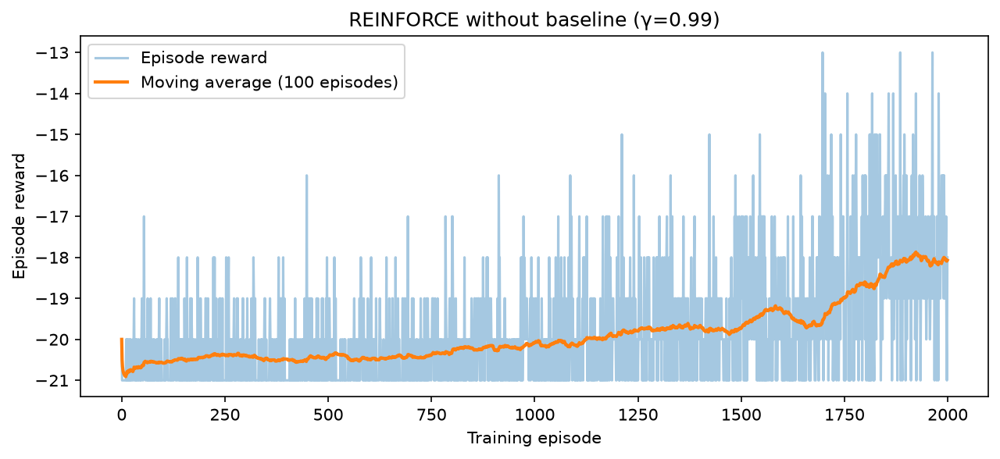

- **Learning starts late but then continues.** The moving average stays at about −20.5 for the first ~700 episodes and then rises steadily to **−18.1 over the last 100 episodes** (first 100: −20.6).
- **It has not converged.** The largest gain comes in the last 500 episodes, so the 2,000-episode budget, not convergence, limits the result.

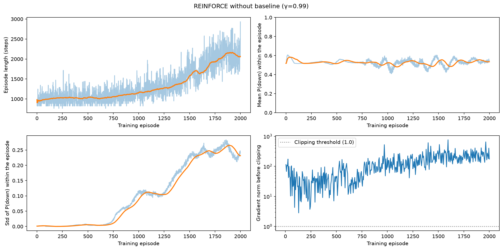

The diagnostics show *how* learning happens, before it is visible in the reward:
- **Std of $P(\text{down})$ within an episode:** below 0.01 for the first ~700 episodes, i.e. the policy outputs the same probability whatever the screen shows. It then rises to 0.23. The policy only starts to depend on the state from episode ~750, which is exactly when reward and episode length start to rise.
- **Mean $P(\text{down})$** stays between 0.4 and 0.6, so the policy never collapses to a single action. The initial bias of the random network (0.58) is removed within ~100 episodes.
- **Episode length** doubles from ~1,000 to ~2,100 steps: the agent returns the ball more often, so rallies last longer.
- **Gradient norm** grows from ~35 to ~235 (median of the first and last 50 updates). The loss is a sum over all steps of 5 episodes, so longer episodes add more terms, which explains at most a factor of ~2. The rest is probably because the policy now reacts consistently: early on, the steps push in random directions and mostly cancel; later, many steps push the same weights in the same direction. This does not affect training, since clipping and Adam make the step size independent of the gradient norm.

### Evaluation

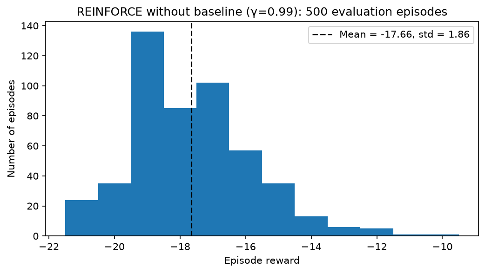

**Mean = −17.66, std = 1.86** over 500 episodes. 95% of the episodes score better than the random policy (−20.4), and the best episode reaches −10. The policy wins about 3 points per game, but still loses every game.

### Edge Cases

| Edge case | Handling |
|---|---|
| Sparse rewards | Only every ~95 steps (median rally of the trained policy) is a reward ≠ 0. The return restart keeps every return in $[-1, 1]$ and assigns each point only to its rally (Check 1). |
| No motion in a single frame | The frame difference shows direction and speed. In the first step of an episode it is all 0 (tested). |
| Restricted action space | Only actions 2 and 3; there is no "stay" action, so the paddle is always moving. |
| `preprocess` modifies its input | The given function writes into a view of the observation. I copy the frame first, so the observation of the environment stays unchanged (tested). |
| Saturated policy | `Bernoulli(probs=sigmoid(50))` gives $\log P(\text{up}) = -15.9$ because PyTorch clamps the probability; the exact value is −50. `logits=` is exact (tested). The entropy bonus keeps the policy away from saturation. |
| End of an episode | Pong-v5 has no relevant step limit (108,000 frames). Every one of 800 evaluation episodes ends by termination when one side has 21 points (tested). |
| Sticky actions | Pong-v5 repeats the previous action with probability 0.25, so games are random even for a fixed policy. Seeding the first `env.reset` and `torch.manual_seed` makes training reproducible: training twice gives identical results (tested). |
| Invalid arguments | `episodes <= 0`, $\gamma \notin (0, 1]$ and `batch_episodes <= 0` raise a `ValueError` (tested). |
| Long training | Checkpoints and log are saved every 250 episodes, so a crash loses at most 250 episodes. |

### Tests for Validating Correctness

The tests are in the **Checks** section of `3b_Pong-v5.ipynb` and reuse the trained policy and its checkpoints. Each test prints `[PASS]` / `[FAIL]`. **All pass except two**, which test a behaviour the policy has not learned (Checks 4 and 5, explained there).

**1. Returns and credit assignment.** A single final reward gives $G_t = \gamma^{T-1-t}$, and with two rallies `[0, 0, −1, 0, 0, +1]`, the first rally only sees its own point: $[-\gamma^2, -\gamma, -1, \gamma^2, \gamma, 1]$ ✓. In a real 2,837-step episode, $|G_t| \le 1$ at every step ✓.

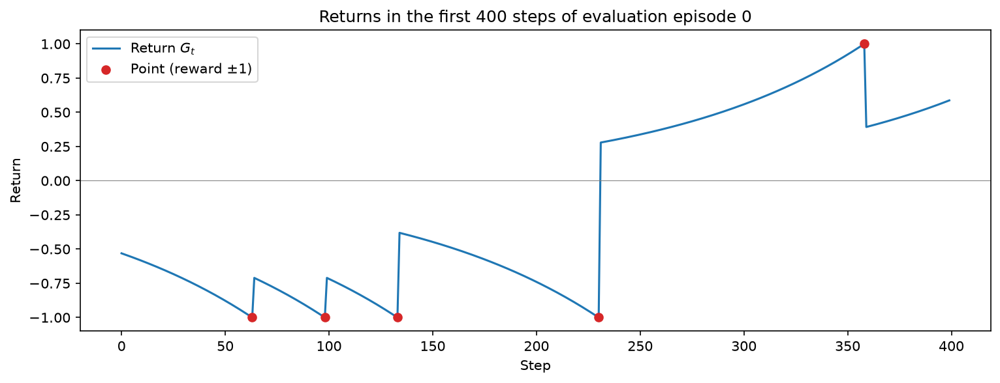

With a median rally of 95 steps, $\gamma^{95} = 0.38$: the first action of a rally still gets 38% of the credit for its point.

**2. Preprocessing, frame difference and actions.** The preprocessed frame only contains 0/1 and the difference only −1/0/+1 ✓. Action 2 moves the paddle to the top ($y = 2$ of 158), action 3 to the bottom ($y = 156$) ✓.

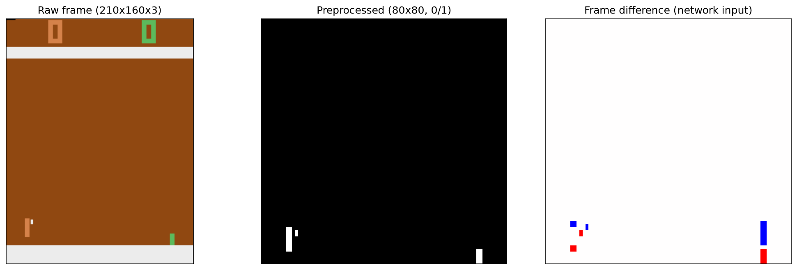

In the difference, the background disappears, and the ball and both paddles appear as +1/−1 pairs. The player's paddle is only visible while it moves.

**3. Comparison with reference policies** (50 episodes each, same start states):

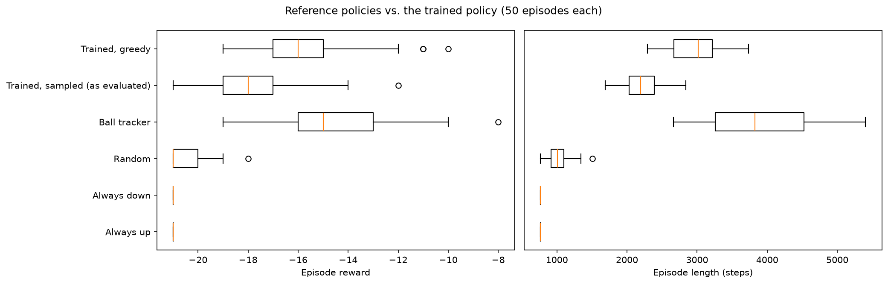

| Policy | Reward | Length (steps) | Points won |
|---|---|---|---|
| Always up / always down | −21.00 ± 0.00 | 764 | 0 |
| Random | −20.40 ± 0.75 | 1,024 | 0.6 |
| Ball tracker (hand-coded) | −14.74 ± 2.16 | 3,876 | 6.3 |
| **Trained, sampled** (first 50 evaluation episodes) | **−18.02 ± 1.83** | 2,217 | 3.0 |
| Trained, greedy | −15.68 ± 2.37 | 2,960 | 5.3 |

- The *ball tracker* is not trained. It always moves the paddle towards the ball, using the ball and paddle positions read from the pixels. It shows what the two actions can achieve and serves as a reference.
- **The trained policy is clearly better than random** ✓ and closes a bit less than half of the gap between random and the ball tracker.
- **Even the ball tracker loses**, because returning the ball is not enough: a point is only won when the opponent misses, which requires steep shots off the edge of the paddle.
- **The greedy policy is better than the sampled one** (−15.68 vs. −18.02). I chose sampled actions for the main evaluation before training, because a policy that is still close to 0.5 everywhere can turn into "always the same action" when acted on greedily. After training, the policy is decisive enough that removing the sampling noise helps.

**4. Does the policy react to the ball?** For every checkpoint (8 episodes each), I compare $P(\text{down})$ in two pairs of situations:
- **Direction gap:** ball moving down vs. ball moving up. The frame difference shows this directly.
- **Position gap:** ball below vs. above the paddle (by more than 10 pixels), only while the ball approaches the player.

Both gaps are 0 for a policy that ignores the ball. I use gaps instead of correlations, because while $P(\text{down})$ barely varies, a correlation only measures noise.

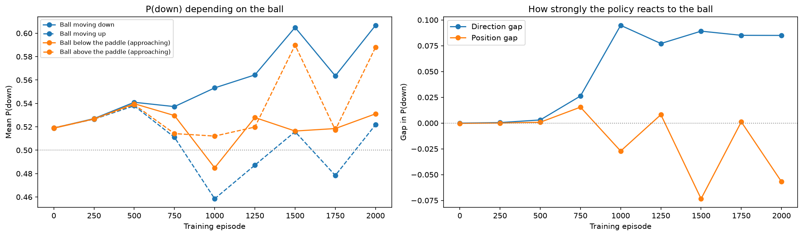

| Checkpoint | 0 | 500 | 750 | 1,000 | 1,500 | 2,000 |
|---|---|---|---|---|---|---|
| Direction gap | 0.000 | +0.003 | +0.026 | +0.095 | +0.089 | **+0.085** |
| Position gap | 0.000 | +0.001 | +0.015 | −0.027 | −0.073 | **−0.057** |

- **Initial policy ignores the ball** (both gaps 0) ✓.
- **The policy learns to move with the ball's vertical direction** ✓. The direction gap appears at episode 750, exactly when the std of $P(\text{down})$ and the reward start to rise.
- **[FAIL] It does not learn to move towards the ball's position.** The position gap never becomes clearly positive and is even negative at the end. This is a property of the learned policy, not a bug in the check: the check is 0 for the untrained policy and works with the same position data that make the ball tracker succeed. The likely reason is the input: the ball's direction is directly visible in the frame difference, but the paddle only appears in it while it moves, so "ball above or below the paddle" is much harder to learn. Following the ball's direction keeps the paddle roughly in line with the ball, which explains the longer rallies. It also explains why the policy stays far below the ball tracker.

**5. First 10 steps.** The 10 steps before the first point of evaluation episode 0:

| $t$ | 54 | 55 | 56 | 57 | 58 | 59 | 60 | 61 | 62 | 63 |
|---|---|---|---|---|---|---|---|---|---|---|
| Ball − paddle (px) | −79 | −53 | −43 | −32 | −26 | −36 | −50 | −44 | −20 | −10 |
| $P(\text{down})$ | 0.24 | 0.21 | 0.32 | 0.56 | 0.62 | 0.62 | 0.67 | 0.69 | 0.60 | 0.75 |
| Action | up | down | up | down | down | down | up | up | down | down |
| Reward | 0 | 0 | 0 | 0 | 0 | 0 | 0 | 0 | 0 | −1 |

- **[FAIL] The more likely action points towards the ball in only 3 of 10 steps.** The ball is above the paddle the whole time but moving down (its $y$ rises from 50 to 121). $P(\text{down})$ rises with it, from 0.24 to 0.75, so the policy follows the ball's motion, not its position: the same behaviour as in Check 4.
- The paddle therefore moves down with the ball instead of waiting for it, and the point is lost.

### Summary of 3b

| | Value |
|---|---|
| Training reward, first / last 100 episodes | −20.57 / −18.07 |
| Episode length, first / last 100 episodes | 993 / 2,065 steps |
| Evaluation (500 episodes, sampled) | **−17.66 ± 1.86** |
| Reference: random / ball tracker | −20.40 / −14.74 |
| Learned behaviour | Moves with the ball's vertical direction, not towards its position |

REINFORCE without a baseline learns Pong, but slowly: for the first ~700 of 2,000 episodes the policy does not react to the screen at all. It then learns the feature that is easiest to see in the frame difference, the ball's direction, and doubles the rally length. It still loses every game and was still improving when training ended.

# 3 Policy Gradient: Part 2

## 3a) CartPole-v1 With a Baseline

**Notebook:** `3a_CartPole-v1.ipynb`, section **Part 2**. All figures are saved to `report/figures/3a_baseline_*.png`. Training takes about 30 min, the checks about 3 min. Part 2 only needs the definition cells of Part 1, not its trainings.

**Setup:** I take the best configuration from Part 1 ($\gamma = 0.995$, cosine scheduler 0.01 → 0.001, reward shaping) and change only one thing: whether a baseline is subtracted from the returns. The baseline averages over several episodes, so **both** variants update the policy on batches of $N = 5$ episodes (200 updates for 1,000 episodes). Without a baseline, this is the Part 1 algorithm with batches. The scheduler is stepped once per update, i.e. `T_max` = 200. Evaluation is as in Part 1: 500 greedy episodes on the same start states.

### Chosen Baseline and Implementation

**Non-constant baseline: the average return at the same step of the other episodes of the batch.** For episode $i$ at step $t$:

$$b_t^{(i)} = \frac{1}{N-1} \sum_{j \neq i} G_t^{(j)}, \qquad G_t^{(j)} = 0 \text{ if episode } j \text{ has already ended at step } t,$$

and the loss becomes $-\frac{1}{N} \sum_i \sum_t \log \pi(a_t^{(i)} \mid s_t^{(i)})\,\big(G_t^{(i)} - b_t^{(i)}\big)$.

| Design choice | Reason |
|---|---|
| Per step instead of one constant | With $\gamma = 0.995$, the return falls steadily over an episode (Part 1, Test 1). One constant would be too small at the start and too large at the end of every episode. Comparing step $t$ with step $t$ of the other episodes removes this trend, so the advantage measures how much better than the others the episode is doing *from this point on*. |
| Leave-one-out ($j \neq i$) | The baseline must not depend on the episode's own actions; otherwise the gradient is biased. Averaging only over the *other* episodes guarantees this. |
| $G_t^{(j)} = 0$ after the end | An episode that has already failed collects no more reward. An episode that survives longer than the others therefore gets a positive advantage for its late steps. |
| A full batch of identical episodes gives no update | If all episodes reach the 500-step limit with the same rewards, all advantages are 0. With a constant baseline instead, the return shrinking towards the time limit would make the last steps of a successful episode look worse than average, and their (good) actions would be pushed down. |

**Implementation** (`compute_advantages`): the returns of the batch are padded with zeros into an $N \times T_{\max}$ matrix. The leave-one-out mean at every step is $(\text{column sum} - \text{own row}) / (N-1)$; it is subtracted from each episode's returns and cut back to the episode's length. The function also supports a constant baseline (mean return over all steps of the batch), which is only used for comparison in Test 8.

### Training and Evaluation (Seed 0)

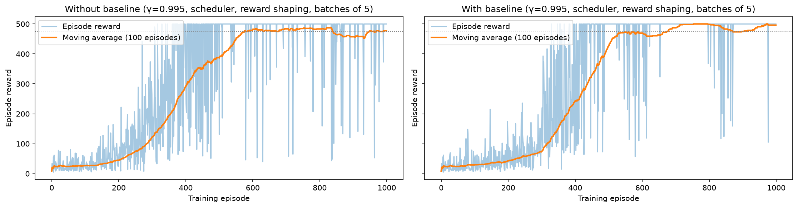

- **Without baseline:** the moving average reaches 475 at episode 576 and stays at ~480 until episode 830. It then drops to ~455 for about 100 episodes and ends at 477.
- **With baseline:** it reaches 475 a bit later (episode 678), then 500 from episode ~720 to ~800. It only dips briefly to ~473 and ends at ~495. Late failures (the downward spikes) are rarer.

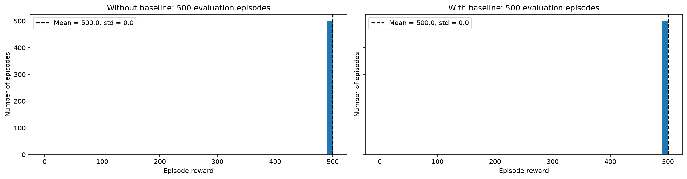

**Evaluation:** both policies reach the limit in all 500 episodes: **mean = 500.0, std = 0.0** for both. As in Part 1, the greedy evaluation of a single seed cannot separate the variants, so the comparison relies on the 5 seeds.

### Comparison Over 5 Seeds

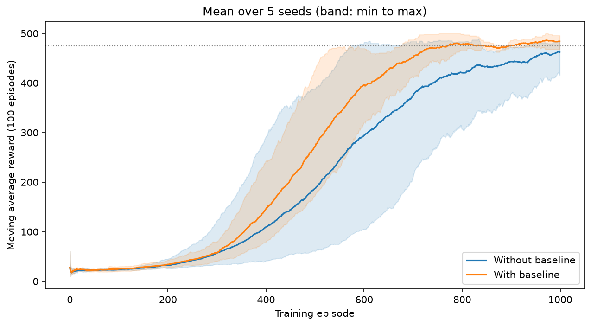

| Variant | Solved at (seeds 0–4) | Mean training reward | Mean of last 100 | Greedy evaluation (500 episodes) | Sampled evaluation (100 episodes) |
|---|---|---|---|---|---|
| Without baseline | 576, –, –, 745, 893 | 240.1 ± 52.6 | 462.1 ± 25.2 | 500.0 (exactly 500 for 4/5 seeds) | 462.3 |
| **With baseline** | 678, 831, 801, 701, 715 | **281.7 ± 27.7** | **484.0 ± 10.5** | **500.0 (5/5 seeds)** | **488.9** |

(– = not solved within 1,000 episodes; ± = std over the 5 seeds)

- **The baseline helps consistently.** Without it, 2 of 5 seeds never reach the solved threshold; with it, all 5 do. The mean training reward is 17% higher and the last 100 episodes are 22 points better.
- **The seeds agree much more:** the std over seeds halves (52.6 → 27.7 over training, 25.2 → 10.5 at the end), and the min–max band is much narrower. This is the effect a lower-variance gradient should have: training depends less on which episodes happen to be sampled.
- **The final policies are more robust:** with sampled actions, they reach 488.9 instead of 462.3.
- **Batching alone costs speed.** The best Part 1 run (one update per episode, 1,000 updates) reached 475 at episodes 327–659 for all 5 seeds. With batches of 5, there are only 200 updates. The baseline recovers the reliability (5/5 solved, last 100 = 484.0 vs. 494.6 in Part 1), but not the speed. Within the fair comparison (both batched), the baseline is clearly better.

### Edge Cases

The edge cases of Part 1 (time limit, reward shaping, invalid $\gamma$, reproducibility) apply unchanged.

| Edge case | Handling |
|---|---|
| Episodes of different lengths | The returns are padded with 0 after an episode ends (Test 7), which is the true return after the end. |
| Batch of identical episodes | All advantages are exactly 0, so no update. This matters most at the time limit, when all episodes are truncated at 500 (Test 7). |
| Only one episode per batch | Leave-one-out has no other episode to average over, so `batch_size = 1` with the per-step baseline raises a `ValueError` (tested). |
| Batch size does not divide the episodes | Would silently drop the remaining episodes, so it raises a `ValueError` (tested). An unknown baseline name is rejected as well. |
| Scheduler with batches | Stepped once per update, so `T_max = episodes // batch_size`; the learning rate ends exactly at 0.001 (tested). With `T_max = episodes`, it would only reach 0.0091. |
| Baseline must not bias the gradient | Leave-one-out: the baseline of an episode does not depend on that episode (Test 7). |
| Fair comparison | Same configuration, batch size, seeds and evaluation start states; only the baseline differs. |

### Tests for Validating Correctness

The tests are in the **Part 2 Checks** section of the notebook and continue the numbering of Part 1. Each test prints `[PASS]` / `[FAIL]`, and all of them pass.

**7. Advantages on hand-made batches.** `compute_advantages` gives the expected result on batches with known answers ($\gamma = 0.995$, reward 1 per step):
- 5 identical episodes of 500 steps: every per-step advantage is exactly 0 ✓.
- **Leave-one-out:** replacing episode 0 by a longer one does not change its own baseline ✓.
- After all other episodes have ended, the advantage of the longest episode equals its return ✓.
- The constant baseline's advantages sum to 0 ✓; without a baseline, the advantages are the returns ✓.

Advantages for a batch with episode lengths 30, 80, 120, 200 and 60:

| Episode (length) | $t = 0$ | $t = 29$ | $t = 59$ | $t = 119$ | $t = 199$ |
|---|---|---|---|---|---|
| 0 (30) | −55.8 | −64.6 | – | – | – |
| 1 (80) | −8.2 | −9.4 | −18.8 | – | – |
| 2 (120) | 22.3 | 25.7 | 22.1 | −15.7 | – |
| 3 (200) | 67.5 | 78.1 | 82.9 | 66.5 | 1.0 |
| 4 (60) | −25.8 | −29.8 | −42.5 | – | – |

Episodes that fail earlier than the others get negative advantages, and the longest episode gets positive ones. Without a baseline, every step of every episode would get a positive weight. Episode 2 turns negative near its end: its own remaining return goes towards 0, while episode 3 is still running and has a large return ahead.

**8. Variance of the gradient estimate.** A baseline should lower the variance of the gradient estimate without changing its expected value. I measure this directly: for a **fixed** policy, I sample 50 batches of 5 episodes. On the same episodes, I compute each batch's gradient three times: without baseline, with a constant baseline (batch mean), and with the per-step baseline. The total variance is $\frac{1}{M}\sum_m \lVert g_m - \bar g \rVert^2$.

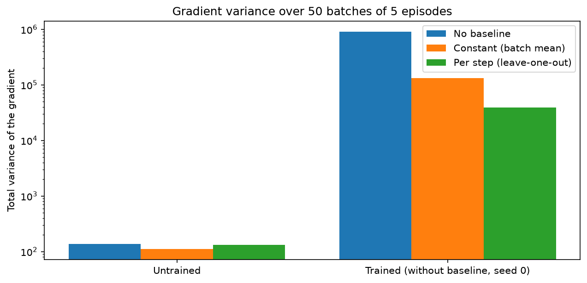

| Policy | Baseline | Total variance | Relative to no baseline | Cosine of mean gradient with no baseline |
|---|---|---|---|---|
| Untrained | None | 138 | 1.000 | 1.000 |
| | Constant | 112 | 0.807 | 0.993 |
| | Per step | 132 | 0.953 | 0.988 |
| Trained (without baseline, seed 0) | None | $9.0 \cdot 10^5$ | 1.000 | 1.000 |
| | Constant | $1.3 \cdot 10^5$ | 0.148 | −0.511 |
| | Per step | $3.9 \cdot 10^4$ | **0.043** | −0.256 |

- **For the trained policy, the per-step baseline reduces the variance by a factor of 23** (the constant baseline by 7) ✓. Its episodes are long and all returns are large and positive (up to ~114 with shaped rewards). Without a baseline, every action is pushed up with a large weight, and the gradient mainly reflects which actions happened to be sampled. The baseline removes this common part. The per-step version also removes the decline of the return within an episode, which the constant one cannot.
- **For the untrained policy, the reduction is small** (factor 0.95) ✓. All episodes are short (~20 steps) with similar returns, so there is little common part to remove.
- **Same direction:** for the untrained policy, the mean gradients with and without baseline point in the same direction (cosine 0.99) ✓, as expected for an unbiased baseline. For the trained policy, the cosine is negative. With a variance of $9 \cdot 10^5$, the mean of 50 batches without baseline still has a standard error of about $\sqrt{9 \cdot 10^5 / 50} \approx 134$ in norm. Near the optimum, the true gradient is small, so 50 batches cannot estimate its direction: this cosine is dominated by noise and not informative.

This is the mechanism behind the training results: the seeds without a baseline differ much more, because their gradient steps depend much more on chance.

### Summary of 3a, Part 2

| | Without baseline | With baseline (per step, leave-one-out) |
|---|---|---|
| Solved (5 seeds) | 3/5 | **5/5** |
| Mean of last 100 episodes (5 seeds) | 462.1 ± 25.2 | **484.0 ± 10.5** |
| Sampled evaluation (5 seeds) | 462.3 | **488.9** |
| Greedy evaluation, seed 0 | 500.0 ± 0.0 | 500.0 ± 0.0 |
| Gradient variance, trained policy | 1 | **0.043** |

The per-step baseline lowers the gradient variance by more than an order of magnitude once episodes get long. As a result, training is more reliable and consistent across seeds, and the final policies are more robust.

---

## 3b) Pong-v5 With a Baseline

**Notebook:** `3b_Pong-v5.ipynb`, section **Part 2**. All figures are saved to `report/figures/3b_baseline_*.png`. Training takes about 2 h 45 min, evaluation and checks about 80 min. The run is saved to `checkpoints/3b/actor_critic/`, and all evaluations and checks are cached there, so with `RETRAIN = False` and `RECOMPUTE = False` Part 2 runs again in seconds. It only needs the definition cells of Part 1.

**Setup:** everything is identical to Part 1: network, frame difference, $\gamma = 0.99$, return restart after every point, learning rate 0.001, 5 episodes per update, entropy bonus, clipping, 2,000 episodes and seed 0. The only change is the weight of the log-probabilities in the actor's loss. Pong training is too slow for several seeds, so the comparison is **one run per variant** (see the limitations at the end).

### Chosen Baseline and Implementation

**Non-constant baseline: a learned state value $V(s_t)$ (actor-critic).** The actor is weighted with the advantage

$$A_t = G_t - V(s_t),$$

where $V$ is a second network, the *critic*, which learns to predict the return of the current rally.

| Design choice | Reason |
|---|---|
| Critic: same layers as the policy, own Adam optimizer (lr 0.001, clipped to norm 1) | Trained on the same Monte-Carlo returns with the loss $\frac{1}{T}\sum_t (V(s_t) - G_t)^2$, updated together with the actor every 5 episodes. |
| Monte-Carlo return $G_t$, not a bootstrapped TD target | $V(s_t)$ does not depend on the action $a_t$, so $\mathbb{E}[\nabla \log \pi(a_t \mid s_t)\, V(s_t)] = 0$: the expected gradient is the same as in Part 1, only its variance changes. A TD target would also reduce the variance, but bias the gradient. |
| Critic input: current frame **and** frame difference (2×80×80) | The value of a state depends on where the paddle is relative to the ball, which the frame difference alone mostly hides (Part 1, Check 4). Any input that does not depend on $a_t$ keeps the baseline unbiased. |
| $V$ is detached in the advantage | The actor's loss does not train the critic, and the critic's loss does not change the actor. |
| State-dependent instead of constant | Returns vary strongly within an episode: close to −1 just before a lost point, close to +1 before a won one. A constant cannot follow this; $V(s_t)$ can. |

**Implementation** (`train_actor_critic`): `sample_episode` plays an episode exactly as in Part 1 and also stores the critic's inputs as `int8`. After the episode, `critic_values` computes $V(s_t)$ for all steps in chunks of 256 steps and accumulates the critic's gradient. The actor's loss is then $-\sum_t \log \pi(a_t \mid s_t)\,(G_t - V(s_t)) - 0.01 \sum_t \mathcal{H}_t$. Every 5 episodes, both networks are clipped and updated.

### Training and Evaluation

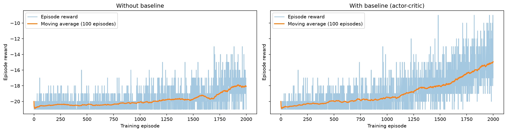

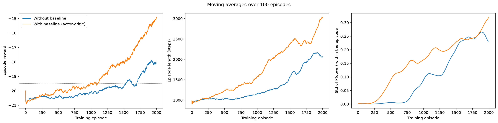

- **Learning starts much earlier.** With the baseline, the policy starts reacting to the screen (std of $P(\text{down})$) at episode ~250 instead of ~750, and the reward rises from the start. The moving average reaches −19.5 at episode **990 instead of 1,530**.
- **It learns faster for the whole run.** The last 100 episodes reach **−14.93 instead of −18.07**, and the rallies are 50% longer (3,028 vs. 2,065 steps).
- **Still improving at the end,** even more steeply than without baseline.

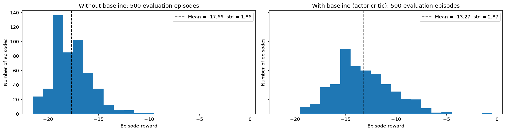

| | Without baseline | With baseline (actor-critic) |
|---|---|---|
| Mean training reward | −19.83 | **−18.74** |
| Reward, last 100 training episodes | −18.07 | **−14.93** |
| Moving average reaches −19.5 at episode | 1,530 | **990** |
| **Evaluation, sampled (500 episodes)** | **−17.66 ± 1.86** | **−13.27 ± 2.87** |
| Evaluation, greedy (50 episodes) | −15.68 ± 2.37 | **−10.22 ± 3.33** |
| Greedy: points won per game / length | 5.3 / 2,960 | **10.8 / 3,847** |
| *Reference:* random / ball tracker (Part 1, Check 3) | −20.40 / −14.74 | |

- **The evaluation improves by 4.4 points.** Every one of the 500 episodes is better than the random policy, and the best one reaches −1. The policy still loses every game.
- **It now beats the hand-coded ball tracker** (−13.27 sampled, −10.22 greedy, vs. −14.74). Without the baseline, it stayed clearly below it.
- **The larger std (2.87 vs. 1.86)** mostly reflects the wider range of results: a better player has more room between losing 21:0 and winning many points.

### What the Critic Learns

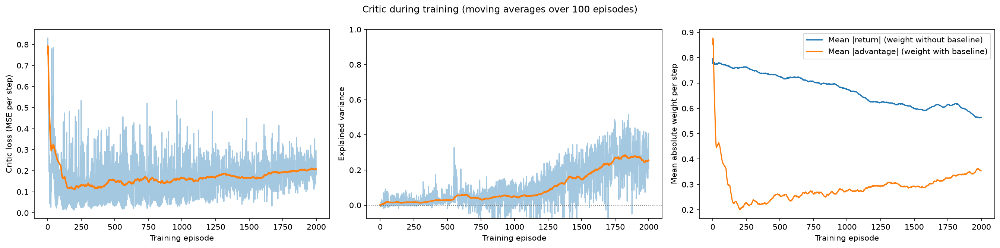

- **First, the critic learns the average return.** Its loss drops from 0.8 to ~0.12 within ~150 episodes. Most returns are negative (the agent loses most points), and subtracting this average alone shrinks the actor's weights from a mean $|G_t|$ of ~0.78 to a mean $|A_t|$ of ~0.22 within the first 200 episodes.
- **Then it learns to tell states apart.** The explained variance $1 - \mathrm{Var}(G - V)/\mathrm{Var}(G)$ stays below 0.05 for the first 1,000 episodes and rises to **0.26** over the last 100. The critic increasingly predicts *which* rallies will be won.
- **The critic's loss rises slowly again** (0.12 → 0.21). As the agent wins more points, the returns spread over the whole range from −1 to +1 and become harder to predict.

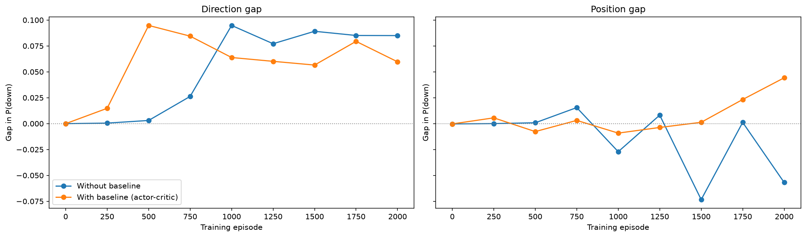

| Checkpoint | 250 | 500 | 1,000 | 1,500 | 2,000 |
|---|---|---|---|---|---|
| Direction gap, without / with baseline | 0.000 / **+0.015** | +0.003 / **+0.095** | +0.095 / +0.064 | +0.089 / +0.057 | +0.085 / +0.060 |
| Position gap, without / with baseline | 0.000 / +0.006 | +0.001 / −0.008 | −0.027 / −0.009 | −0.073 / +0.001 | −0.057 / **+0.044** |

- **The direction gap appears about 500 episodes earlier** (+0.095 at episode 500, a level Part 1 only reaches at episode 1,000). It is the same feature as in Part 1, learned faster.
- **The position gap becomes positive at the end** (+0.044 at episode 2,000, vs. −0.057 without baseline). This is a first sign that the policy also starts moving *towards* the ball, but it is below the threshold of 0.05 used in Part 1 and based on 8 episodes, so it is only a hint.

### Edge Cases

The edge cases of Part 1 (sparse rewards, frame difference, saturation, end of an episode, sticky actions) apply unchanged.

| Edge case | Handling |
|---|---|
| Biased baseline | A baseline must not depend on the action $a_t$. The critic only sees the frames *before* $a_t$, and its value is detached in the advantage (tested). The Monte-Carlo target keeps the gradient unbiased. |
| Untrained critic at the start | The untrained critic predicts ~+0.09, while the returns average ~−0.76. For the first ~100 episodes it is therefore a bad baseline: the mean $|A_t|$ is even slightly larger than $|G_t|$, and the gradient variance is 1.2× that without baseline (Check 8). It learns the average within ~150 episodes. I did not pre-train the critic, so both runs start identically. |
| Critic lags behind the improving policy | The critic is trained on returns of earlier, worse policies, so it is too pessimistic (mean $V$ −0.44 vs. mean $G$ −0.25, Check 7). This does not bias the gradient; it only makes the variance reduction smaller than with a perfect critic. |
| Unbounded critic output | $G_t \in [-1, 1]$, but the critic's output is not bounded. 1% of its predictions lie outside $[-1, 1]$ (lowest −1.41). As a baseline this is harmless, so I did not add a `tanh`. |
| Long episodes (up to ~4,000 steps) | The critic's forward/backward pass runs in chunks of 256 steps, and its inputs are stored as `int8` (12.8 KB per step). The chunked pass gives exactly the same values, loss and gradients as one pass (tested). |
| Fair comparison | Same seed and same initial actor weights. The critic is initialised with `torch.random.fork_rng`, so it does not shift the random numbers used for sampling: the first 5 episodes (before the first update) are identical to Part 1 (tested). |
| Wrong optimizer | A critic optimizer that does not optimise exactly the critic's parameters would silently leave the critic untrained. It raises a `ValueError` (tested), as do the invalid inputs of Part 1. |
| Reproducibility | Training twice with the same seed gives identical results, including the critic's loss (tested). |

### Tests for Validating Correctness

The tests are in the **Part 2 Checks** section of `3b_Pong-v5.ipynb` and run after the training; Checks 7 and 8 are cached. Each test prints `[PASS]` / `[FAIL]`, and **all of them pass**.

**6. Fair setup and advantage computation.**
- The actor starts from exactly the same weights as in Part 1, and the first 5 episodes are identical (rewards −20, −21, −21, −21, −21) ✓. Every later difference is caused by the baseline.
- The values in the advantage carry no gradient ✓.
- The chunked critic pass equals a single pass (values, loss and gradients) ✓.
- The explained variance is 1 for $V = G$ and 0 for $V = \bar G$ ✓.

**7. Does the critic predict the return?** 10 episodes of the final actor, evaluated with the untrained and the final critic on the same steps:


| | Untrained critic | Final critic |
|---|---|---|
| Explained variance | 0.000 | **0.325** ✓ |
| Mean $V$ over the 20 steps before a **won** point (91 points) | | **+0.10** |
| Mean $V$ over the 20 steps before a **lost** point (210 points) | | **−0.61** ✓ |

- The final critic clearly separates rallies that will be won from those that will be lost, and in the test episode its value rises before every won point.
- **Calibration:** the actual return increases monotonically with the predicted value (all 10 deciles), but lies 0.2–0.4 above it. The critic is too pessimistic, because it lags behind the improving policy (edge cases).

**8. Variance of the gradient estimate.** As in CartPole: for a fixed actor and critic, 20 batches of 5 episodes, with the gradient of every batch computed on the same episodes without baseline, with a constant baseline (the batch's mean return) and with the critic. The entropy term is left out.


| Checkpoint | Baseline | Total variance | Relative to no baseline | Cosine of mean gradient with no baseline |
|---|---|---|---|---|
| After 0 episodes | None | $3.5 \cdot 10^3$ | 1.00 | 1.00 |
| | Constant (batch mean) | $5.3 \cdot 10^2$ | 0.15 | 0.70 |
| | Critic (untrained) | $4.2 \cdot 10^3$ | 1.20 | 1.00 |
| After 2,000 episodes | None | $4.7 \cdot 10^5$ | 1.00 | 1.00 |
| | Constant (batch mean) | $2.5 \cdot 10^5$ | 0.52 | 0.99 |
| | **Critic (trained)** | $\mathbf{1.4 \cdot 10^5}$ | **0.29** ✓ | 0.96 |

- **The trained critic reduces the variance by a factor of 3.5**, clearly more than the constant baseline (factor 1.9) ✓. Once the agent wins points, a constant cannot follow the returns, which now vary between rallies.
- **At the start, the constant baseline is better and the untrained critic slightly harmful.** Almost all returns are negative, so their mean removes most of the noise; the untrained critic subtracts the wrong constant (+0.09). This is the same effect as in the edge cases. During training, the critic learns this mean within the first ~150 episodes.
- **Same direction:** the mean gradients with the baselines point in the same direction as without (cosine 0.96–1.00), as expected for unbiased baselines. With 20 batches this is only a rough check; the 0.70 of the constant baseline at the start comes from the noise of the untrained policy's small gradient.
- The variance grows ~130× over training, because episodes are ~3× longer and the policy's gradients larger (Part 1, training diagnostics).

### Summary of 3b, Part 2

| | Without baseline | With baseline (actor-critic) |
|---|---|---|
| Policy starts reacting to the screen | episode ~750 | **episode ~250** |
| Moving average reaches −19.5 | episode 1,530 | **episode 990** |
| Reward, last 100 training episodes | −18.07 | **−14.93** |
| Evaluation, sampled (500 episodes) | −17.66 ± 1.86 | **−13.27 ± 2.87** |
| Evaluation, greedy (50 episodes) | −15.68 ± 2.37 | **−10.22 ± 3.33** |
| Gradient variance, final policy | 1 | **0.29** |

The learned baseline makes REINFORCE on Pong learn much faster: the policy starts reacting to the ball about 500 episodes earlier, and after the same 2,000 episodes it wins about twice as many points and beats the hand-coded ball tracker. The critic learns first the average return and later which rallies will be won, and in the end reduces the gradient variance by a factor of 3.5. **Limitation:** this is a single run per variant. The difference is large and consistent over the whole run, but without several seeds I cannot quantify how much of it depends on the seed.

---

# 3.3 Question: "Given an Additional 3 Months, What Other Validation Tests and Experiments Would You Perform?"

**The algorithms look correct.** In both games, the agent learns, all checks of the implementation pass, the baselines reduce the gradient variance as predicted, and both Pong runs were still improving when training stopped. The main limitation is training time, especially for Pong, so most of the 3 months would go into longer and repeated runs, and into finding out which changes make learning faster.

### CartPole (3a)

- **Remove the time limit.** The greedy evaluation is saturated at 500 steps, and Test 6 showed that the γ = 0.995 policy drifts towards the edge of the track and would probably fail in a longer episode. Evaluating with 5,000 or more steps would reveal such slow failures.
- **Robustness to disturbances:** random pushes on the cart, noise on the observations, and different pole lengths or masses. This tests whether the policy really balances or just memorised the start states.
- **Energy:** measure how much the cart moves (direction changes, distance travelled) and penalise wasted movement in the reward. A good policy should balance with as little movement as possible, and this would show whether the learned policies push back and forth unnecessarily.
- **More seeds (e.g. 20)** for all variants, to get reliable confidence intervals for the differences in Parts 1 and 2.
- **A learned critic for CartPole** as well, to compare it with the leave-one-out baseline on the same task.

### Pong (3b)

- **Train much longer.** Both runs were still improving after 2,000 episodes, and the actor-critic run was improving even faster at the end. Training for 10,000–20,000 episodes would show how good the agent gets, and whether it eventually wins games against the built-in opponent (reward > 0). Since the algorithm learns and all checks pass, this mainly needs time.
- **Several seeds for both variants.** At ~2.5 h per run, 5 seeds per variant are feasible and would confirm that the baseline's advantage is not a lucky seed.
- **Network architecture.** The current CNN has only 8 channels and two max-pooling layers, so the final feature map is only 18×18 for a ball of 1×2 pixels. This low resolution and the frame difference (which hides the paddle when it does not move) probably explain why the policy follows the ball's direction rather than its position (Check 4). I would compare:
  - two stacked frames instead of the difference (as the critic already uses), so the actor sees the paddle's position;
  - more channels, strided convolutions instead of pooling, or the full 160×160 resolution;
  - a small MLP on hand-extracted features (ball and paddle positions and velocities), as an upper bound on what the representation allows.
- **Energy and actions:** add the `NOOP` action, measure how much the paddle moves, and penalise wasted movement. Currently the paddle can never stand still, which makes it jitter around the ball.
- **Hyperparameters:** learning rate, batch size, entropy coefficient, γ, and normalised advantages, each compared on learning speed.
- **Better validation of the critic:** the ALE can save and restore the game state. From saved states, many rollouts give the true value $V^\pi(s)$, which the critic's predictions can be compared with directly. With more batches, the unbiasedness test of Check 8 could also be made precise.
- **Harder evaluation:** other game modes and difficulties of the opponent, and without sticky actions.

### More Advanced Methods (both games)

- **Better policy-gradient methods:** A2C with a TD(λ) / GAE critic and parallel environments, and **PPO**, which reuses each batch for several clipped updates and is much more sample-efficient.
- **Value-based and model-based methods:** DQN as the classic Atari baseline, and world-model methods such as **Dreamer**, which learn a model of the game and train the policy in imagination.
- **Benchmark:** compare all variants (REINFORCE, the baselines, the architectures, A2C, PPO, DQN, Dreamer) on the same budget and several seeds, measuring the episodes, environment steps and wall-clock time needed to reach fixed rewards (e.g. −15, 0, +15 in Pong). This would show which modification learns fastest and is worth its extra complexity.
